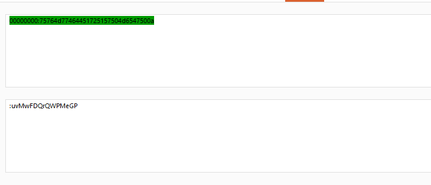

```bash
┌──(d4fl0n㉿kali)-[~/HackMyvm]
└─$ ssh hacker@venus.hackmyvm.eu -p 5000
The authenticity of host '[venus.hackmyvm.eu]:5000 ([152.53.147.208]:5000)' can't be established.
ED25519 key fingerprint is: SHA256:3Zbnq3j3LK+sUDMZKDiyEkLa6i1kV+3DMDISnmXwT8U
This key is not known by any other names.
Are you sure you want to continue connecting (yes/no/[fingerprint])? yes
Warning: Permanently added '[venus.hackmyvm.eu]:5000' (ED25519) to the list of known hosts.

                                                      .     **                                   
                                                   *           *.                                 
                                                                  ,*                              
                                                                     *,                            
                                             ,                         ,*                         
                                          .,                              *,                       
                                       /                                    *                    
                                    ,*                                        *,                  
                                 /.                                            .*.                 
                                      _____                                                        
              _______    ______   _____\    \  _____    _____ ______   _____                _____   
              \      |  |      | /    / |    ||\    \   \    \     \  \    \          _____\    \  
              |     /  /     /|/    /  /___/| \    \   |    |\    |  |    |         /    / \    | 
              |\    \  \    |/|    |__ |___|/  \    \  |    | |   |  |    |        |    |  /___/| 
              \ \    \ |    | |       \         \|    \ |    | |    \_/   /|     ____\    \ |   || 
                \|     \|    | |     __/ __       |     \|    | |\         \|    /    /\    \|___|/ 
                |\         /| |\    \  /  \     /     /\      \| \         \__ |    |/ \    \      
                | \_______/ | | \____\/    |   /_____/ /______/|\ \_____/\    \|\____\ /____/|     
                  \ |     | /  | |    |____/|  |      | |     | | \ |    |/___/|| |   ||    | |     
                  \|_____|/    \|____|   | |  |______|/|_____|/   \|____|   | | \|___||____|/      
                                      |___|/                             |___|/                     
                                                    
                                       **                                    **.                    
                                          ,*                                **                       
                                             *,                          ,*                          
                                                *                      **                            
                                                *,                .*                              
                                                   *.           **                                 
                                                      **      ,*,                                 
                                                         ** *, 
                                        [== HMVLabs Chapter 1: Venus ==]

                                         +===========================+
                                         |        Respect &          |
                                         |        Have fun!          |
                                         |                           |
                                         | https://hackmyvm.eu/venus |
                                         +===========================+

                                          
hacker@venus.hackmyvm.eu's password: 

Linux venus 6.12.73+deb13-amd64 #1 SMP PREEMPT_DYNAMIC Debian 6.12.73-1 (2026-02-17) x86_64

                                                      .     **                                   
                                                   *           *.                                 
                                                                  ,*                              
                                                                     *,                            
                                             ,                         ,*                         
                                          .,                              *,                       
                                       /                                    *                    
                                    ,*                                        *,                  
                                 /.                                            .*.                 
                                      _____                                                        
              _______    ______   _____\    \  _____    _____ ______   _____                _____   
              \      |  |      | /    / |    ||\    \   \    \     \  \    \          _____\    \  
              |     /  /     /|/    /  /___/| \    \   |    |\    |  |    |         /    / \    | 
              |\    \  \    |/|    |__ |___|/  \    \  |    | |   |  |    |        |    |  /___/| 
              \ \    \ |    | |       \         \|    \ |    | |    \_/   /|     ____\    \ |   || 
                \|     \|    | |     __/ __       |     \|    | |\         \|    /    /\    \|___|/ 
                |\         /| |\    \  /  \     /     /\      \| \         \__ |    |/ \    \      
                | \_______/ | | \____\/    |   /_____/ /______/|\ \_____/\    \|\____\ /____/|     
                  \ |     | /  | |    |____/|  |      | |     | | \ |    |/___/|| |   ||    | |     
                  \|_____|/    \|____|   | |  |______|/|_____|/   \|____|   | | \|___||____|/      
                                      |___|/                             |___|/                     
                                                    
                                       **                                    **.                    
                                          ,*                                **                       
                                             *,                          ,*                          
                                                *                      **                            
                                                *,                .*                              
                                                   *.           **                                 
                                                      **      ,*,                                 
                                                         ** *, 
                                        [== HMVLabs Chapter 1: Venus ==]

                                         +===========================+
                                         |        Respect &          |
                                         |        Have fun!          |
                                         |                           |
                                         | https://hackmyvm.eu/venus |
                                         +===========================+

                                          
hacker@venus:~$ 
```

## Mission


```bash
hacker@venus:~$ cat mission.txt 
################
# MISSION 0x01 #
################

## EN ##
User sophia has saved her password in a hidden file in this folder. Find it and log in as sophia.

## ES ##
La usuaria sophia ha guardado su contraseña en un fichero oculto en esta carpeta.Encuentralo y logueate como sophia.
```

Notre première mission était de trouver le mot de passe de `sophia` dans le répertoire courant

```bash
hacker@venus:~$ ls -la
total 36
. . . .
-rw-r-----  1 root   hacker   16 May  4  2026 .myhiddenpazz
. . . .
```

nous avons fichier appeler mon mot de passe cacher lisons le

```bash
hacker@venus:~$ cat .myhiddenpazz 
Y1o645M3mR84ejc
```

Essayons de se connecter au compte de `sophia` avec le mot de passe trouver 

```bash
hacker@venus:~$ su sophia
Password: 
sophia@venus:/pwned/hacker$ id
uid=1002(sophia) gid=1002(sophia) groups=1002(sophia)
```

nous somme connecter au compte de `sophia`

## Mission 02


```bash
sophia@venus:~$ cat mission.txt 
################
# MISSION 0x02 #
################

## EN ##
The user angela has saved her password in a file but she does not remember where ... she only remembers that the file was called whereismypazz.txt 

## ES ##
La usuaria angela ha guardado su password en un fichero pero no recuerda donde... solo recuerda que el fichero se llamaba whereismypazz.txt
```

notre mission étais de retrouver le mot de passe de l'utilisateur `angela` elle ne sait pas où elle l'a enregistré mais elle connais au moins le nom du fichier dans la quel se trouve son mot de passe 

nous allons utiliser la commande `find` avec le `type` définie sur le fichier ainsi que le nom `whereismypazz.txt`

```bash
sophia@venus:~$ find / -type f -name "whereismypazz.txt" 2>/dev/null
/usr/share/whereismypazz.txt
sophia@venus:~$ 
```

lisons le fichier trouver

```bash
sophia@venus:~$ cat /usr/share/whereismypazz.txt
oh5p9gAABugHBje
sophia@venus:~$ 
```

connexion au compte de `angela`

```bash
sophia@venus:~$ su angela
Password: 
angela@venus:/pwned/sophia$ id
uid=1003(angela) gid=1003(angela) groups=1003(angela),1054(www3)
angela@venus:/pwned/sophia$ 
```


## Mission 03

```bash
angela@venus:~$ cat mission.txt 
################
# MISSION 0x03 #
################

## EN ##
The password of the user emma is in line 4069 of the file findme.txt

## ES ##
La password de la usuaria emma esta en la linea 4069 del fichero findme.txt
```

notre mission était de retrouver le mot de passe de l'utilisateur `emma` qui se trouve à la ligne 4069 du fichier findme.txt

vérifions d'abord le nombre de ligne de fichier `findme.txt`

```bash
angela@venus:~$ cat findme.txt | wc -l
4618
angela@venus:~$ 
```

le fichier contient 4618 ligne et nous c'est la ligne 4069 qui nous intéressé dans ce cas j'ai plusieurs solution je peux utilise la commande `head` ou `tail`

```bash
angela@venus:~$ head -n 4069 findme.txt | tail -n 1
fIvltaGaq0OUH8O
angela@venus:~$
```

nous avons trouver la ligne, essayons la connexion au compte de `emma`

```bash
angela@venus:~$ su emma
Password: 
emma@venus:/pwned/angela$ id
uid=1004(emma) gid=1004(emma) groups=1004(emma)
```


## Mission 04

```bash
emma@venus:~$ cat mission.txt 
################
# MISSION 0x04 #
################

## EN ##
User mia has left her password in the file -.
## ES ##
La usuaria mia ha dejado su password en el fichero -.
```

notre mission était de retrouver le mot de passe de `mia` dans le fichier `-`

```bash
emma@venus:~$ ls -la
total 32
-rw-r-----  1 root emma   16 May  4  2026 -

```

lisons le fichier

```bash
emma@venus:~$ more -
iKXIYg0pyEH2Hos
```

connexion au compte de `mia`

```bash
emma@venus:~$ su mia
Password: 
mia@venus:/pwned/emma$ id
uid=1005(mia) gid=1005(mia) groups=1005(mia)
```

## Mission 05

```bash
mia@venus:~$ cat mission.txt 
################
# MISSION 0x05 #
################

## EN ##
It seems that the user camila has left her password inside a folder called hereiam 

## ES ##
Parece que la usuaria camila ha dejado su password dentro de una carpeta llamada hereiam
```

notre mission était de retrouver le mot de passe de `camila` dans le dossier `hereiam`

cherchons d'abord le dossier `hereiam`

```bash
mia@venus:~$ find / -type d -name 'hereiam' 2>/dev/null
/opt/hereiam
```

trouvons le fichier qui se trouve dans le ce dossier et lisons le 

```bash
total 12
drwxr-xr-x 2 root root 4096 May  4  2026 .
drwxr-xr-x 1 root root 4096 May  4  2026 ..
-rw-r--r-- 1 root root   16 May  4  2026 .here
```


```bash
mia@venus:~$ cat /opt/hereiam/.here 
F67aDmCAAgOOaOc
```

connexion au compte de `camila`

```bash
mia@venus:~$ su camila
Password: 
camila@venus:/pwned/mia$ id
uid=1006(camila) gid=1006(camila) groups=1006(camila)
camila@venus:/pwned/mia$ 
```

## Mission 06

```bash
camila@venus:~$ cat mission.txt 
################
# MISSION 0x06 #
################

## EN ##
The user luna has left her password in a file inside the muack folder. 

## ES ##
La usuaria luna ha dejado su password en algun fichero dentro de la carpeta muack.
```

notre mission était de retrouver le mot de passe de `luna` dans le répertoire `muack`

```bash
camila@venus:~$ ls -la
total 40
-rw-r-----   1 root   camila    31 May  4  2026 flagz.txt
-rw-r-----   1 root   camila   226 May  4  2026 mission.txt
drwxr-xr-x 551 root   root   12288 May  4  2026 muack
```

```bash
camila@venus:~/muack$ grep -Erni "" . 2>/dev/null
./111/111/muack:1:j3vkuoKQwvbhkMc
```

confirmons le fichier 

```bash
camila@venus:~/muack$ ls -la 111/111/muack 
-rw-r----- 1 root camila 16 May  4  2026 111/111/muack

```

```bash
camila@venus:~/muack$ cat 111/111/muack
j3vkuoKQwvbhkMc
```

connexion au compte de `luna`

```bash
camila@venus:~/muack$ su luna
Password: 
luna@venus:/pwned/camila/muack$ id
uid=1007(luna) gid=1007(luna) groups=1007(luna)
luna@venus:/pwned/camila/muack$ 
```

## Mission 07

```bash
luna@venus:~$ cat mission.txt 
################
# MISSION 0x07 #
################

## EN ##
The user eleanor has left her password in a file that occupies 6969 bytes. 

## ES ##
La usuaria eleanor ha dejado su password en un fichero que ocupa 6969 bytes.

```

notre prochaine mission était de trouver le mot de passe de `eleanor` qui est dans un fichier qui fait `6969 bytes`

nous allons utilisé la commande `find` avec l'option `size` pour filtrer en fonction de la taille du fichier

```bash
luna@venus:~$ find / -size 6969c 2>/dev/null
/usr/share/moon.txt
```

lisons le fichier

```bash
luna@venus:~$ cat /usr/share/moon.txt
UNDchvln6Bmtu7b

```


connexion au compte `eleanor`

```bash
eleanor@venus:~$ id
uid=1008(eleanor) gid=1008(eleanor) groups=1008(eleanor)
eleanor@venus:~$ 
```

## Mission 08

```bash
eleanor@venus:~$ cat mission.txt 
################
# MISSION 0x08 #
################

## EN ##
The user victoria has left her password in a file in which the owner is the user violin. 

## ES ##
La usuaria victoria ha dejado su password en un fichero en el cual el propietario es el usuario violin.

```

notre mission était de retrouve le not de passe de `victoria` dans un fichier appartenant a l'utilisateur `violin`


```bash
eleanor@venus:~$ find / -user violin 2>/dev/null
/usr/local/games/yo
```

lisons le fichier 

```bash
eleanor@venus:~$ cat /usr/local/games/yo
pz8OqvJBFxH0cSj
```

connexion au compte `victoria`

```bash
eleanor@venus:~$ su victoria
Password: 
victoria@venus:/pwned/eleanor$ id
uid=1009(victoria) gid=1009(victoria) groups=1009(victoria)
victoria@venus:/pwned/eleanor$ 
```

## Mission 09

```bash
victoria@venus:~$ cat mission.txt 
################
# MISSION 0x09 #
################

## EN ##
The user isla has left her password in a zip file.

## ES ##
La usuaria isla ha dejado su password en un fichero zip.
```

notre mission était de retrouver le mot de passe de `isla` dans un fichier `zip`


```bash
victoria@venus:~$ ls -la
total 32
-rw-r-----  1 root     victoria   31 May  4  2026 flagz.txt
-rw-r-----  1 root     victoria  179 May  4  2026 mission.txt
-rw-r-----  1 root     victoria  220 May  4  2026 passw0rd.zip
```

décompressons le fichier 

```bash
victoria@venus:~$ unzip passw0rd.zip 
Archive:  passw0rd.zip
checkdir error:  cannot create pwned
                 Permission denied
                 unable to process pwned/victoria/passw0rd.txt.
```

nous n'avons pas la permission essayons de voir avec le répertoire `/tmp`

```bash
victoria@venus:~$ ls -la /tmp/
ls: cannot open directory '/tmp/': Permission denied
```

nous avons pas la permission sur le répertoire `/tmp`

utilisons la commande strings pour récupérer toutes les chaines de caractère

```bash
victoria@venus:~$ strings passw0rd.zip
pwned/victoria/passw0rd.txtUT	
D3XTob0FUImsoBb
pwned/victoria/passw0rd.txtUT
```

connexion au compte `isla`

```bash
victoria@venus:~$ su isla
Password: 
isla@venus:/pwned/victoria$ id
uid=1010(isla) gid=1010(isla) groups=1010(isla)
```

## Mission 10

```bash
isla@venus:~$ cat mission.txt 
################
# MISSION 0x10 #
################

## EN ##
The password of the user violet is in the line that begins with a9HFX (these 5 characters are not part of her password.). 

## ES ##
El password de la usuaria violet esta en la linea que empieza por a9HFX (sin ser estos 5 caracteres parte de su password.).
```

cette fois-ci notre mission était de retrouver le mot de passe de l'utilisateur `violet` dans un mot qui commence par `a9HFX`

```bash
isla@venus:~$ ls -la
. . . .
-rw-r-----  1 root isla 16968 May  4  2026 passy

```

dans le répertoire nous avons ce fichier sa doit être dans le fichier que nous allons chercher notre mot de passe

vérifions le nombre de ligne 

```bash
isla@venus:~$ cat passy | wc -l
808
```

c'est fichier a 808 ligne nous allons applique le filtre pour trouver la ligne qui commence par `a9HFX`

```bash
isla@venus:~$ grep ^a9HFX passy 
a9HFXWKINVzNQLKLDVAc
```

d'après la description du mission ces 5 caractères ne font pas partie du mot de passe

donc le mot de passe sera `WKINVzNQLKLDVAc`

connexion au compte de `violet`


```bash
isla@venus:~$ su violet 
Password: 
violet@venus:/pwned/isla$ id
uid=1011(violet) gid=1011(violet) groups=1011(violet)
```


## Mission 11

```bash
violet@venus:~$ cat mission.txt 
################
# MISSION 0x11 #
################

## EN ##
The password of the user lucy is in the line that ends with 0JuAZ (these last 5 characters are not part of her password) 

## ES ##
El password de la usuaria lucy se encuentra en la linea que acaba por 0JuAZ (sin ser estos ultimos 5 caracteres parte de su password)
```

notre mission était de retrouver le mot de passe de `lucy` qui se trouver sur la ligne qui se termine par `0JuAZ` 

```bash
violet@venus:~$ grep -i 0JuAZ end 
OCmMUjebG53giud0JuAZ
```

les 5 dernières caractères ne font pas partie du mot de passe, donc le mot de passe de `lucy` est `OCmMUjebG53giud`

connexion au compte de `lucy`

```bash
violet@venus:~$ su lucy
Password: 
lucy@venus:/pwned/violet$ id
uid=1012(lucy) gid=1012(lucy) groups=1012(lucy)
lucy@venus:/pwned/violet$ 
```

## Mission 12 

```bash
lucy@venus:~$ cat mission.txt 
################
# MISSION 0x12 #
################

## EN ##
The password of the user elena is between the characters fu and ck 

## ES ##
El password de la usuaria elena esta entre los caracteres fu y ck
```

la mission était de retrouver le mot de passe de `elena` qui se trouver entre les caractères `fu et ck`

```bash
lucy@venus:~$ ls -l 
total 24
-rw-r----- 1 root lucy 12720 May  4  2026 file.yo
-rw-r----- 1 root lucy    31 May  4  2026 flagz.txt
-rw-r----- 1 root lucy   205 May  4  2026 mission.txt
```

```bash
lucy@venus:~$ wc -l file.yo 
606 file.yo

```

nous avons 606 lignes

```bash
lucy@venus:~$ grep -Po '(?<=fu).*(?=ck)' file.yo
4xZ5lIKYmfPLg9t
```

le mot de passe de `elena` est `4xZ5lIKYmfPLg9t`


```bash
lucy@venus:~$ su elena
Password: 
elena@venus:/pwned/lucy$ id
uid=1013(elena) gid=1013(elena) groups=1013(elena)
elena@venus:/pwned/lucy$ 
```

## Mission 13

```bash
elena@venus:~$ cat mission.txt 
################
# MISSION 0x13 #
################

## EN ##
The user alice has her password is in an environment variable. 

## ES ##
La password de alice esta en una variable de entorno.
```

le but de la mission est de trouver le mot de passe de `alice` stocker dans la variable d'environnement de `elena`


```bash
elena@venus:~$ env
. . . .
USER=elena
PASS=Cgecy2MY2MWbaqt
. . . .
```

connexion au compte de `alice`

```bash
elena@venus:~$ su alice
Password: 
alice@venus:/pwned/elena$ id
uid=1014(alice) gid=1014(alice) groups=1014(alice)
alice@venus:/pwned/elena$ 
```

## Mission 14

```bash
alice@venus:~$ cat mission.txt 
################
# MISSION 0x14 #
################

## EN ##
The admin has left the password of the user anna as a comment in the file passwd. 

## ES ##
El admin ha dejado la password de anna como comentario en el fichero passwd.
```

notre mission était le lire le `fichier` `passwd` pour récupérer le mot de passe de `anna` laissé par l'admin

```bash
alice@venus:~$ cat /etc/passwd
. . . .
alice:x:1014:1014:w8NvY27qkpdePox:/pwned/alice:/bin/bash
. . . .
```

le mot de passe est `w8NvY27qkpdePox`

connexion au compte de `anna`

```bash
alice@venus:~$ su anna
Password: 
anna@venus:/pwned/alice$ id
uid=1015(anna) gid=1015(anna) groups=1015(anna)
anna@venus:/pwned/alice$
```

## Mission 15

```bash
anna@venus:~$ cat mission.txt 
################
# MISSION 0x15 #
################

## EN ##
Maybe sudo can help you to be natalia.

## ES ##
Puede que sudo te ayude para ser natalia.
```

notre mission est de se connecter au compte de `natalia` via `sudo`

```bash
anna@venus:~$ sudo -l
Matching Defaults entries for anna on venus:
    env_reset, mail_badpass, secure_path=/usr/local/sbin\:/usr/local/bin\:/usr/sbin\:/usr/bin\:/sbin\:/bin, use_pty

User anna may run the following commands on venus:
    (natalia) NOPASSWD: /bin/bash
```

passons de compte `anna` --> `natalia`

```bash
anna@venus:~$ sudo -u natalia /bin/bash
natalia@venus:/pwned/anna$ id
uid=1016(natalia) gid=1016(natalia) groups=1016(natalia)
natalia@venus:/pwned/anna$ 
```

## Mission 16

```bash
8===JWHa1GQq1AYrBWNXEJrH===D~~
natalia@venus:~$ cat mission.txt 
################
# MISSION 0x16 #
################

## EN ##
The password of user eva is encoded in the base64.txt file

## ES ##
El password de eva esta encodeado en el fichero base64.txt
```

l'objectif de cette mission et de trouver le mot de passe de `eva` encode dans un fichier appeler `base64.txt`

lisons le fichier pour voir de quel type d'encodage s'agit-il

```bash
natalia@venus:~$ cat base64.txt 
dXBzQ0EzVUZ1MTBmREFPCg==
```

il s'agit belle et bien du base64 décodons le 

```bash
natalia@venus:~$ cat base64.txt  | base64 -d
upsCA3UFu10fDAO
```

connexion au compte `eva`

```bash
┌──(d4fl0n㉿kali)-[~/HackMyvm]
└─$ ssh eva@venus.hackmyvm.eu -p 5000

                                                      .     **                                   
                                                   *           *.                                 
                                                                  ,*                              
                                                                     *,                            
                                             ,                         ,*                         
                                          .,                              *,                       
                                       /                                    *                    
                                    ,*                                        *,                  
                                 /.                                            .*.                 
                                      _____                                                        
              _______    ______   _____\    \  _____    _____ ______   _____                _____   
              \      |  |      | /    / |    ||\    \   \    \     \  \    \          _____\    \  
              |     /  /     /|/    /  /___/| \    \   |    |\    |  |    |         /    / \    | 
              |\    \  \    |/|    |__ |___|/  \    \  |    | |   |  |    |        |    |  /___/| 
              \ \    \ |    | |       \         \|    \ |    | |    \_/   /|     ____\    \ |   || 
                \|     \|    | |     __/ __       |     \|    | |\         \|    /    /\    \|___|/ 
                |\         /| |\    \  /  \     /     /\      \| \         \__ |    |/ \    \      
                | \_______/ | | \____\/    |   /_____/ /______/|\ \_____/\    \|\____\ /____/|     
                  \ |     | /  | |    |____/|  |      | |     | | \ |    |/___/|| |   ||    | |     
                  \|_____|/    \|____|   | |  |______|/|_____|/   \|____|   | | \|___||____|/      
                                      |___|/                             |___|/                     
                                                    
                                       **                                    **.                    
                                          ,*                                **                       
                                             *,                          ,*                          
                                                *                      **                            
                                                *,                .*                              
                                                   *.           **                                 
                                                      **      ,*,                                 
                                                         ** *, 
                                        [== HMVLabs Chapter 1: Venus ==]

                                         +===========================+
                                         |        Respect &          |
                                         |        Have fun!          |
                                         |                           |
                                         | https://hackmyvm.eu/venus |
                                         +===========================+

                                          
eva@venus.hackmyvm.eu's password: 
eva@venus:~$ id
uid=1017(eva) gid=1017(eva) groups=1017(eva)
```

## Mission 17

```bash
eva@venus:~$ cat mission.txt 
################
# MISSION 0x17 #
################

## EN ##
The password of the clara user is found in a file modified on May 1, 1968. 

## ES ##
La password de la usuaria clara se encuentra en un fichero modificado el 01 de Mayo de 1968.
```

l'objectif de cette mission est de trouver le mot de passe de `clara` dans un fichier modifier le `1 mai 1968`

```bash
eva@venus:~$ find / -type f -mtime +20000 -mtime -21000 2>/dev/null
/usr/lib/cmdo
eva@venus:~$
```

lisons le fichier

```bash
eva@venus:~$ cat /usr/lib/cmdo
39YziWp5gSvgQN9
```

connexion au compte de `clara`


```bash
eva@venus:~$ su clara
Password: 
clara@venus:/pwned/eva$ id
uid=1018(clara) gid=1018(clara) groups=1018(clara)
```

## Mission 18

```bash
clara@venus:~$ cat mission.txt 
################
# MISSION 0x18 #
################

## EN ##
The password of user frida is in the password-protected zip (rockyou.txt can help you) 

## ES ##
La password de frida esta en el zip protegido con password.(rockyou.txt puede ayudarte)
```

l'objectif est de trouver le  mot de passe de l'utilisateur `frida` qui se trouve dans le fichier zip protégé par mot de passe (rockyou.txt peut vous aider).


```bash
clara@venus:~$ ls -l
total 12
-rw-r----- 1 root clara  31 May  4  2026 flagz.txt
-rw-r----- 1 root clara 247 May  4  2026 mission.txt
-rw-r----- 1 root clara 244 May  4  2026 protected.zip

```

récupérons le fichier sur notre machine


```bash
┌──(d4fl0n㉿kali)-[~/HackMyvm]
└─$ scp -P 5000 clara@venus.hackmyvm.eu:/pwned/clara/protected.zip .

                                                      .     **                                   
                                                   *           *.                                 
                                                                  ,*                              
                                                                     *,                            
                                             ,                         ,*                         
                                          .,                              *,                       
                                       /                                    *                    
                                    ,*                                        *,                  
                                 /.                                            .*.                 
                                      _____                                                        
              _______    ______   _____\    \  _____    _____ ______   _____                _____   
              \      |  |      | /    / |    ||\    \   \    \     \  \    \          _____\    \  
              |     /  /     /|/    /  /___/| \    \   |    |\    |  |    |         /    / \    | 
              |\    \  \    |/|    |__ |___|/  \    \  |    | |   |  |    |        |    |  /___/| 
              \ \    \ |    | |       \         \|    \ |    | |    \_/   /|     ____\    \ |   || 
                \|     \|    | |     __/ __       |     \|    | |\         \|    /    /\    \|___|/ 
                |\         /| |\    \  /  \     /     /\      \| \         \__ |    |/ \    \      
                | \_______/ | | \____\/    |   /_____/ /______/|\ \_____/\    \|\____\ /____/|     
                  \ |     | /  | |    |____/|  |      | |     | | \ |    |/___/|| |   ||    | |     
                  \|_____|/    \|____|   | |  |______|/|_____|/   \|____|   | | \|___||____|/      
                                      |___|/                             |___|/                     
                                                    
                                       **                                    **.                    
                                          ,*                                **                       
                                             *,                          ,*                          
                                                *                      **                            
                                                *,                .*                              
                                                   *.           **                                 
                                                      **      ,*,                                 
                                                         ** *, 
                                        [== HMVLabs Chapter 1: Venus ==]

                                         +===========================+
                                         |        Respect &          |
                                         |        Have fun!          |
                                         |                           |
                                         | https://hackmyvm.eu/venus |
                                         +===========================+

                                          
clara@venus.hackmyvm.eu's password: 
protected.zip                                                                                                                                                                                               100%  244     0.7KB/s   00:00    
```

nous avons récupérer le fichier sur notre machine, récupérons le hash du fichier

```bash
┌──(d4fl0n㉿kali)-[~/HackMyvm]
└─$ ls
protected.zip
```

```bash
┌──(d4fl0n㉿kali)-[~/HackMyvm]
└─$ zip2john protected.zip                               
ver 1.0 efh 5455 efh 7875 protected.zip/pwned/clara/protected.txt PKZIP Encr: 2b chk, TS_chk, cmplen=28, decmplen=16, crc=239F7473 ts=3CFB cs=3cfb type=0
protected.zip/pwned/clara/protected.txt:$pkzip$1*2*2*0*1c*10*239f7473*0*53*0*1c*3cfb*c823ce3573963877a93bbeb1ac7b6faa2a0b84d76afa70012cc57f3a*$/pkzip$:pwned/clara/protected.txt:protected.zip::protected.zip
```

décryptons le hash récupérer

```bash
┌──(d4fl0n㉿kali)-[~/HackMyvm]
└─$ john --wordlist=/usr/share/wordlists/rockyou.txt hash
Using default input encoding: UTF-8
Loaded 1 password hash (PKZIP [32/64])
Will run 3 OpenMP threads
Press 'q' or Ctrl-C to abort, almost any other key for status
pass123          (protected.zip/pwned/clara/protected.txt)     
1g 0:00:00:00 DONE (2026-11-03 10:47) 12.50g/s 76800p/s 76800c/s 76800C/s 123456..iheartyou
Use the "--show" option to display all of the cracked passwords reliably
Session completed. 
```

le mot de passe du zip est `pass123`

dézippons le fichier

```bash
┌──(d4fl0n㉿kali)-[~/HackMyvm]
└─$ unzip protected.zip 
Archive:  protected.zip
[protected.zip] pwned/clara/protected.txt password: 
 extracting: pwned/clara/protected.txt
```

```bash
┌──(d4fl0n㉿kali)-[~/HackMyvm]
└─$ cat pwned/clara/protected.txt 
Ed4ErEUJEaMcXli

```

le mot de passe de `frida` est `Ed4ErEUJEaMcXli`

connexion au `frida`

```bash
┌──(d4fl0n㉿kali)-[~/HackMyvm]
└─$ ssh frida@venus.hackmyvm.eu -p 5000

                                                      .     **                                   
                                                   *           *.                                 
                                                                  ,*                              
                                                                     *,                            
                                             ,                         ,*                         
                                          .,                              *,                       
                                       /                                    *                    
                                    ,*                                        *,                  
                                 /.                                            .*.                 
                                      _____                                                        
              _______    ______   _____\    \  _____    _____ ______   _____                _____   
              \      |  |      | /    / |    ||\    \   \    \     \  \    \          _____\    \  
              |     /  /     /|/    /  /___/| \    \   |    |\    |  |    |         /    / \    | 
              |\    \  \    |/|    |__ |___|/  \    \  |    | |   |  |    |        |    |  /___/| 
              \ \    \ |    | |       \         \|    \ |    | |    \_/   /|     ____\    \ |   || 
                \|     \|    | |     __/ __       |     \|    | |\         \|    /    /\    \|___|/ 
                |\         /| |\    \  /  \     /     /\      \| \         \__ |    |/ \    \      
                | \_______/ | | \____\/    |   /_____/ /______/|\ \_____/\    \|\____\ /____/|     
                  \ |     | /  | |    |____/|  |      | |     | | \ |    |/___/|| |   ||    | |     
                  \|_____|/    \|____|   | |  |______|/|_____|/   \|____|   | | \|___||____|/      
                                      |___|/                             |___|/                     
                                                    
                                       **                                    **.                    
                                          ,*                                **                       
                                             *,                          ,*                          
                                                *                      **                            
                                                *,                .*                              
                                                   *.           **                                 
                                                      **      ,*,                                 
                                                         ** *, 
                                        [== HMVLabs Chapter 1: Venus ==]

                                         +===========================+
                                         |        Respect &          |
                                         |        Have fun!          |
                                         |                           |
                                         | https://hackmyvm.eu/venus |
                                         +===========================+

                                          
frida@venus.hackmyvm.eu's password: 
frida@venus:~$ id
uid=1019(frida) gid=1019(frida) groups=1019(frida)
```

## Mission 19

```bash
frida@venus:~$ cat mission.txt 
################
# MISSION 0x19 #
################

## EN ##
The password of eliza is the only string that is repeated (unsorted) in repeated.txt. 

## ES ##
La password de eliza es el unico string que se repite (sin estar ordenado) en repeated.txt.
```

le mot de passe de `eliza` se trouve en double sans trié dans le fichier `repeated.txt`

```bash
frida@venus:~$ cat repeated.txt | wc -l
4591
```


```bash
frida@venus:~$ cat repeated.txt | uniq -d
Fg6b6aoksceQqB9
frida@venus:~$ 
```

connexion au compte de `eliza`

```bash
frida@venus:~$ su eliza
Password: 
eliza@venus:/pwned/frida$ id
uid=1020(eliza) gid=1020(eliza) groups=1020(eliza)
```

## Mission 20

```bash
eliza@venus:~$ cat mission.txt 
################
# MISSION 0x20 #
################

## EN ##
The user iris has left me her key.

## ES ##
La usuaria iris me ha dejado su key.
```

trouver la clé de l'utilisateur `iris` et de se connecter a son compte

```bash
eliza@venus:~$ ls -la
. . . .
-rw-r-----  1 root  eliza 2602 May  4  2026 .iris_key
```

connexion au compte de `iris` avec la clé


```bash
eliza@venus:~$ ssh -i .iris_key iris@localhost
The authenticity of host 'localhost (::1)' can't be established.
ED25519 key fingerprint is SHA256:3Zbnq3j3LK+sUDMZKDiyEkLa6i1kV+3DMDISnmXwT8U.
This key is not known by any other names.
Are you sure you want to continue connecting (yes/no/[fingerprint])? yes
Could not create directory '/pwned/eliza/.ssh' (Permission denied).
Failed to add the host to the list of known hosts (/pwned/eliza/.ssh/known_hosts).

                                                      .     **                                   
                                                   *           *.                                 
                                                                  ,*                              
                                                                     *,                            
                                             ,                         ,*                         
                                          .,                              *,                       
                                       /                                    *                    
                                    ,*                                        *,                  
                                 /.                                            .*.                 
                                      _____                                                        
              _______    ______   _____\    \  _____    _____ ______   _____                _____   
              \      |  |      | /    / |    ||\    \   \    \     \  \    \          _____\    \  
              |     /  /     /|/    /  /___/| \    \   |    |\    |  |    |         /    / \    | 
              |\    \  \    |/|    |__ |___|/  \    \  |    | |   |  |    |        |    |  /___/| 
              \ \    \ |    | |       \         \|    \ |    | |    \_/   /|     ____\    \ |   || 
                \|     \|    | |     __/ __       |     \|    | |\         \|    /    /\    \|___|/ 
                |\         /| |\    \  /  \     /     /\      \| \         \__ |    |/ \    \      
                | \_______/ | | \____\/    |   /_____/ /______/|\ \_____/\    \|\____\ /____/|     
                  \ |     | /  | |    |____/|  |      | |     | | \ |    |/___/|| |   ||    | |     
                  \|_____|/    \|____|   | |  |______|/|_____|/   \|____|   | | \|___||____|/      
                                      |___|/                             |___|/                     
                                                    
                                       **                                    **.                    
                                          ,*                                **                       
                                             *,                          ,*                          
                                                *                      **                            
                                                *,                .*                              
                                                   *.           **                                 
                                                      **      ,*,                                 
                                                         ** *, 
                                        [== HMVLabs Chapter 1: Venus ==]

                                         +===========================+
                                         |        Respect &          |
                                         |        Have fun!          |
                                         |                           |
                                         | https://hackmyvm.eu/venus |
                                         +===========================+

                                          
Linux venus 6.12.73+deb13-amd64 #1 SMP PREEMPT_DYNAMIC Debian 6.12.73-1 (2026-02-17) x86_64

                                                      .     **                                   
                                                   *           *.                                 
                                                                  ,*                              
                                                                     *,                            
                                             ,                         ,*                         
                                          .,                              *,                       
                                       /                                    *                    
                                    ,*                                        *,                  
                                 /.                                            .*.                 
                                      _____                                                        
              _______    ______   _____\    \  _____    _____ ______   _____                _____   
              \      |  |      | /    / |    ||\    \   \    \     \  \    \          _____\    \  
              |     /  /     /|/    /  /___/| \    \   |    |\    |  |    |         /    / \    | 
              |\    \  \    |/|    |__ |___|/  \    \  |    | |   |  |    |        |    |  /___/| 
              \ \    \ |    | |       \         \|    \ |    | |    \_/   /|     ____\    \ |   || 
                \|     \|    | |     __/ __       |     \|    | |\         \|    /    /\    \|___|/ 
                |\         /| |\    \  /  \     /     /\      \| \         \__ |    |/ \    \      
                | \_______/ | | \____\/    |   /_____/ /______/|\ \_____/\    \|\____\ /____/|     
                  \ |     | /  | |    |____/|  |      | |     | | \ |    |/___/|| |   ||    | |     
                  \|_____|/    \|____|   | |  |______|/|_____|/   \|____|   | | \|___||____|/      
                                      |___|/                             |___|/                     
                                                    
                                       **                                    **.                    
                                          ,*                                **                       
                                             *,                          ,*                          
                                                *                      **                            
                                                *,                .*                              
                                                   *.           **                                 
                                                      **      ,*,                                 
                                                         ** *, 
                                        [== HMVLabs Chapter 1: Venus ==]

                                         +===========================+
                                         |        Respect &          |
                                         |        Have fun!          |
                                         |                           |
                                         | https://hackmyvm.eu/venus |
                                         +===========================+

                                          
iris@venus:~$ id 
uid=1021(iris) gid=1021(iris) groups=1021(iris)
iris@venus:~$ 

```

```bash
iris@venus:~$ cat irispass.txt 
kYjyoLcnBZ9EJdz
```
## Mission 21

```bash
iris@venus:~$ cat mission.txt 
################
# MISSION 0x21 #
################

## EN ##
User eloise has saved her password in a particular way. 

## ES ##
La usuaria eloise ha guardado su password de una forma particular.
```

le but de la mission était de trouver le mot de passe de `eloise` qui est enregistrer d'une manière particulier


```bash
iris@venus:~$ cat eloise  | head -n 10
/9j/4AAQSkZJRgABAQEAYABgAAD/4RDSRXhpZgAATU0AKgAAAAgABAE7AAIAAAAEc01MAIdpAAQA
AAABAAAISpydAAEAAAAIAAAQwuocAAcAAAgMAAAAPgAAAAAc6gAAAAgAAAAAAAAAAAAAAAAAAAAA
AAAAAAAAAAAAAAAAAAAAAAAAAAAAAAAAAAAAAAAAAAAAAAAAAAAAAAAAAAAAAAAAAAAAAAAAAAAA
AAAAAAAAAAAAAAAAAAAAAAAAAAAAAAAAAAAAAAAAAAAAAAAAAAAAAAAAAAAAAAAAAAAAAAAAAAAA
AAAAAAAAAAAAAAAAAAAAAAAAAAAAAAAAAAAAAAAAAAAAAAAAAAAAAAAAAAAAAAAAAAAAAAAAAAAA
AAAAAAAAAAAAAAAAAAAAAAAAAAAAAAAAAAAAAAAAAAAAAAAAAAAAAAAAAAAAAAAAAAAAAAAAAAAA
AAAAAAAAAAAAAAAAAAAAAAAAAAAAAAAAAAAAAAAAAAAAAAAAAAAAAAAAAAAAAAAAAAAAAAAAAAAA
AAAAAAAAAAAAAAAAAAAAAAAAAAAAAAAAAAAAAAAAAAAAAAAAAAAAAAAAAAAAAAAAAAAAAAAAAAAA
AAAAAAAAAAAAAAAAAAAAAAAAAAAAAAAAAAAAAAAAAAAAAAAAAAAAAAAAAAAAAAAAAAAAAAAAAAAA
AAAAAAAAAAAAAAAAAAAAAAAAAAAAAAAAAAAAAAAAAAAAAAAAAAAAAAAAAAAAAAAAAAAAAAAAAAAA
```

récupérons le fichier sur notre machine attaquant

```bash
┌──(d4fl0n㉿kali)-[~/HackMyvm]
└─$ scp -P 5000 iris@venus.hackmyvm.eu:/pwned/iris/eloise .  

                                                      .     **                                   
                                                   *           *.                                 
                                                                  ,*                              
                                                                     *,                            
                                             ,                         ,*                         
                                          .,                              *,                       
                                       /                                    *                    
                                    ,*                                        *,                  
                                 /.                                            .*.                 
                                      _____                                                        
              _______    ______   _____\    \  _____    _____ ______   _____                _____   
              \      |  |      | /    / |    ||\    \   \    \     \  \    \          _____\    \  
              |     /  /     /|/    /  /___/| \    \   |    |\    |  |    |         /    / \    | 
              |\    \  \    |/|    |__ |___|/  \    \  |    | |   |  |    |        |    |  /___/| 
              \ \    \ |    | |       \         \|    \ |    | |    \_/   /|     ____\    \ |   || 
                \|     \|    | |     __/ __       |     \|    | |\         \|    /    /\    \|___|/ 
                |\         /| |\    \  /  \     /     /\      \| \         \__ |    |/ \    \      
                | \_______/ | | \____\/    |   /_____/ /______/|\ \_____/\    \|\____\ /____/|     
                  \ |     | /  | |    |____/|  |      | |     | | \ |    |/___/|| |   ||    | |     
                  \|_____|/    \|____|   | |  |______|/|_____|/   \|____|   | | \|___||____|/      
                                      |___|/                             |___|/                     
                                                    
                                       **                                    **.                    
                                          ,*                                **                       
                                             *,                          ,*                          
                                                *                      **                            
                                                *,                .*                              
                                                   *.           **                                 
                                                      **      ,*,                                 
                                                         ** *, 
                                        [== HMVLabs Chapter 1: Venus ==]

                                         +===========================+
                                         |        Respect &          |
                                         |        Have fun!          |
                                         |                           |
                                         | https://hackmyvm.eu/venus |
                                         +===========================+

                                          
iris@venus.hackmyvm.eu's password: 
eloise                                                                                                       
```


```bash
┌──(d4fl0n㉿kali)-[~/HackMyvm]
└─$ cat eloise | base64 -d
����JFIF``���ExifMM;sML�J���
                           >������85��85�
                                       �2021:11:10 10:18:032021:11:10 10:18:03sML��
                                                                                   http://ns.adobe.com/xap/1.0/<?xpacket begin='' id='W5M0MpCehiHzreSzNTczkc9d'?>
<x:xmpmeta xmlns:x="adobe:ns:meta/"><rdf:RDF xmlns:rdf="http://www.w3.org/1999/02/22-rdf-syntax-ns#"><rdf:Description rdf:about="uuid:faf5bdd5-ba3d-11da-ad31-d33d75182f1b" xmlns:dc="http://purl.org/dc/elements/1.1/"/><rdf:Description rdf:about="uuid:faf5bdd5-ba3d-11da-ad31-d33d75182f1b" xmlns:xmp="http://ns.adobe.com/xap/1.0/"><xmp:CreateDate>2021-11-10T10:18:03.849</xmp:CreateDate></rdf:Description><rdf:Description rdf:about="uuid:faf5bdd5-ba3d-11da-ad31-d33d75182f1b" xmlns:dc="http://purl.org/dc/elements/1.1/"><dc:creator><rdf:Seq xmlns:rdf="http://www.w3.org/1999/02/22-rdf-syntax-ns#"><rdf:li>sML</rdf:li></rdf:Seq>
			</dc:creator></rdf:Description></rdf:RDF></x:xmpmeta>
```

il s'agit d'une photo redirigeons la sortie d'un fichier 

```bash
┌──(d4fl0n㉿kali)-[~/HackMyvm]
└─$ cat eloise | base64 -d > eloise.jpg

```

```bash
┌──(d4fl0n㉿kali)-[~/HackMyvm]
└─$ exiftool eloise.jpg  
ExifTool Version Number         : 13.55
File Name                       : eloise.jpg
Directory                       : .
File Size                       : 13 kB
File Modification Date/Time     : 2026:11:03 11:18:27-05:00
File Access Date/Time           : 2026:11:03 11:18:31-05:00
File Inode Change Date/Time     : 2026:11:03 11:18:27-05:00
File Permissions                : -rw-rw-r--
File Type                       : JPEG
File Type Extension             : jpg
MIME Type                       : image/jpeg
JFIF Version                    : 1.01
Resolution Unit                 : inches
X Resolution                    : 96
Y Resolution                    : 96
Exif Byte Order                 : Big-endian (Motorola, MM)
Artist                          : sML
Date/Time Original              : 2021:11:10 10:18:03
Create Date                     : 2021:11:10 10:18:03
Sub Sec Time Original           : 85
Sub Sec Time Digitized          : 85
XP Author                       : sML
Padding                         : (Binary data 2060 bytes, use -b option to extract)
About                           : uuid:faf5bdd5-ba3d-11da-ad31-d33d75182f1b
Creator                         : sML
Image Width                     : 394
Image Height                    : 102
Encoding Process                : Baseline DCT, Huffman coding
Bits Per Sample                 : 8
Color Components                : 3
Y Cb Cr Sub Sampling            : YCbCr4:2:0 (2 2)
Image Size                      : 394x102
Megapixels                      : 0.040
Create Date                     : 2021:11:10 10:18:03.85
Date/Time Original              : 2021:11:10 10:18:03.85
```

y'a rien d'intéressent dans la métadonnée, affichons l'image


connexion au compte de `eloise`

`y0UJlVOSH0nbSPm`

connexion au compte `eloise`

```bash
iris@venus:~$ su eloise
Password: 
eloise@venus:/pwned/iris$ id
uid=1022(eloise) gid=1022(eloise) groups=1022(eloise)
eloise@venus:/pwned/iris$ 
```

## Mission 22

```bash
eloise@venus:~$ cat mission.txt 
################
# MISSION 0x22 #
################

## EN ##
User lucia has been creative in saving her password.

## ES ##
La usuaria lucia ha sido creativa en la forma de guardar su password.
```

le but de cette mission est de retrouvé le mot de passe de `lucia`

```bash
eloise@venus:~$ ls -l
total 12
-rw-r----- 1 root eloise  31 May  4  2026 flagz.txt
-rw-r----- 1 root eloise  50 May  4  2026 hi
-rw-r----- 1 root eloise 194 May  4  2026 mission.txt
```


```bash
eloise@venus:~$ cat hi 
00000000: 7576 4d77 4644 5172 5157 504d 6547 500a
```

il s'agit du ASCII/hex nous allons utilise `burp suite` pour le décodé en supprimant les espaces

```
00000000:75764d77464451725157504d6547500a
```



le mot de passe est `uvMwFDQrQWPMeGP`

connexion au compte `lucie`

```bash
eloise@venus:~$ su lucia
Password: 
lucia@venus:/pwned/eloise$ id
uid=1023(lucia) gid=1023(lucia) groups=1023(lucia)
lucia@venus:/pwned/eloise$ 
```

## Mission 23

```bash
lucia@venus:~$ cat mission.txt 
################
# MISSION 0x23 #
################

## EN ##
The user isabel has left her password in a file in the /etc/xdg folder but she does not remember the name, however she has dict.txt that can help her to remember.

## ES ##
La usuaria isabel ha dejado su password en un fichero en la carpeta /etc/xdg pero no recuerda el nombre, sin embargo tiene dict.txt que puede ayudarle a recordar.
```

la mission c'est de retrouver le mot de passe de `isabel` dans le répertoire `/etc/xdg` vérifions le répertoire

```bash
lucia@venus:~$ ls -la /etc/xdg/
ls: cannot open directory '/etc/xdg/': Permission denied
lucia@venus:~$ 
```

nous n'avons la permission de liste le répertoire mais nous avons un fichier `dict.txt` qui nous aidera a retrouver le fichier

```bash
lucia@venus:~$ head -n 10 dict.txt 

s
hack
hacker
handler
hanlder
happening
head
header
headers
```

le fichier `dict.txt` contient une liste de mot donc ce qui nous reviens a l'esprit c'est de faire du brute force

pour trouver le fichier que nous avons la permission de lire dans `/etc/xdg`

nous allons utilisé la boucle `for`  pour résoudre cette mission

```bash
lucia@venus:~$ for i in $(cat dict.txt); do cat /etc/xdg/$i 2>/dev/null; done 
H5ol8Z2mrRsorC0
```

nous avons trouver le mot de passe qui est `H5ol8Z2mrRsorC0`

connexion au compte `isabel`

```bash
lucia@venus:~$ su isabel
Password: 
isabel@venus:/pwned/lucia$ id
uid=1024(isabel) gid=1024(isabel) groups=1024(isabel)
```

## Mission 24

```bash
isabel@venus:~$ cat mission.txt 
################
# MISSION 0x24 #
################

## EN ##
The password of the user freya is the only string that is not repeated in different.txt 

## ES ##
La password de la usuaria freya es el unico string que no se repite en different.txt
```

trouver le mot de passe de `freya` qui est le seul mot de passe unique dans la liste

```bash
isabel@venus:~$ cat different.txt | uniq -u
EEDyYFDwYsmYawj
```

connexion au compte de `freya`

```bash
isabel@venus:~$ su freya
Password: 
freya@venus:/pwned/isabel$ id
uid=1025(freya) gid=1025(freya) groups=1025(freya)
```

## Mission 25

```bash
freya@venus:~$ cat mission.txt 
################
# MISSION 0x25 #
################

## EN ##
User alexa puts her password in a .txt file in /free every minute and then deletes it. 

## ES ##
La usuaria alexa pone su password en un fichero .txt en la carpeta /free cada minuto y luego lo borra.
```

le but de la mission est de récupérer le mot de passe de l'utilisatrice `alexa` place dans un fichier .txt situé dans /free, chaque minute, puis le supprime.

```bash
freya@venus:~$ while true; do cat /free/*.txt 2>/dev/null && break; done
mxq9O3MSxxX9Q3S
```

le mot de passe de `alexa` est `mxq9O3MSxxX9Q3S`

connexion au compte de `alexa`

```bash
freya@venus:~$ su alexa
Password: 
alexa@venus:/pwned/freya$ id
uid=1026(alexa) gid=1026(alexa) groups=1026(alexa)
alexa@venus:/pwned/freya$ 
```


## Mission 26

```bash
alexa@venus:~$ cat mission.txt 
################
# MISSION 0x26 #
################

## EN ##
The password of the user ariel is online! (HTTP)

## ES ##
El password de la usuaria ariel esta online! (HTTP)
```

le mot de passe de `ariel` est en ligne faisons une `curl`  sur le `localhost`

```bash
alexa@venus:~$ curl localhost
33EtHoz9a0w2Yqo
```

connexion au compte de `ariel`


```bash
Password: 
ariel@venus:/pwned/alexa$ id
uid=1027(ariel) gid=1027(ariel) groups=1027(ariel)
ariel@venus:/pwned/alexa$ 
```

## Mission 27

```bash
ariel@venus:~$ cat mission.txt 
################
# MISSION 0x27 #
################

## EN ##
Seems that ariel dont save the password for lola, but there is a temporal file.

## ES ##
Parece ser que a ariel no le dio tiempo a guardar la password de lola... menosmal que hay un temporal!
```


trouvons le mot de passe `lola` dans le fichier temporaire


```bash
ariel@venus:~$ ls -la
. . . .
-rw-r-----  1 root  ariel 12288 May  4  2026 .goas.swp
. . . .
```


```bash
ariel@venus:~$ strings .goas.swp 
b0VIM 8.2
teste
deb11
~teste/goas
U3210
#"! 
qkBjHcaJ
qkBjHcaJ
qkBjHcaJ
-->VVjqJGRrnfKmcgD
-->bnQgcXYamhSDSff
-->QsymOOVbzSaKmRm
-->cbjYGSvqAsqIvdg
-->LkWReDaaLCMDlLf
-->DabEJLmAbOQxEnD
-->mYhQVLDKdJrsIwG
-->d3LieOzRGX5wud6
-->EKvJoTBYlwtwFmv
-->PEOppdOkSqJZweH
-->rSkPlPhymYcerMJ
-->GBUguuSpXVjpxLc
-->NdnszvjulNellbK
-->IaOpTdAuhSjGZnu
-->RGBEMbZHZRgXZnu
--rxhKeFKveeKqpwp
-->cOXlRYXtJWnVQEG
-->ppkJjqYvSCIyAhK
Thats my little DIc with my old and current passw0rds:
```

le mot de passe de `lola` est  `d3LieOzRGX5wud6`

connexion au compte de `lola`

```bash
ariel@venus:~$ su lola
Password: 
lola@venus:/pwned/ariel$ id
uid=1028(lola) gid=1028(lola) groups=1028(lola)
lola@venus:/pwned/ariel$ 
```

## Mission 28

```bash
lola@venus:~$ cat mission.txt 
################
# MISSION 0x28 #
################

## EN ##
The user celeste has left a list of names of possible .html pages where to find her password. 

## ES ##
La usuaria celeste ha dejado un listado de nombres de posibles paginas .html donde encontrar su password.
```

le but de la mission est de faire du brute force avec l'extension `.html` sur `pages.txt`

```bash
lola@venus:~$ ls -l
total 12
-rw-r----- 1 root lola   31 May  4  2026 flagz.txt
-rw-r----- 1 root lola  272 May  4  2026 mission.txt
-rw-r----- 1 root lola 1438 May  4  2026 pages.txt
```


```bash
lola@venus:~$ for i in $(cat pages.txt); do
  code=$(curl -s -o /dev/null -w '%{http_code}' "http://localhost/$i.html")
  [ "$code" = "200" ] && echo "OK  $i.html"
done
OK  cebolla.html
```


```bash
lola@venus:~$ curl -i http://localhost/cebolla.html
HTTP/1.1 200 OK
Server: nginx
Date: Tue, 03 Nov 2026 17:22:45 GMT
Content-Type: text/html
Content-Length: 16
Last-Modified: Mon, 04 May 2026 07:40:19 GMT
Connection: keep-alive
ETag: "69f84d63-10"
Accept-Ranges: bytes

VLSNMTKwSV2o8Tn
```

connexion au compte `celeste`

```bash
-rw-r----- 1 root lola 1438 May  4  2026 pages.txt
lola@venus:~$ su celeste
Password: 
celeste@venus:/pwned/lola$ id
uid=1029(celeste) gid=1029(celeste) groups=1029(celeste)
celeste@venus:/pwned/lola
```

## Mission 29

```bash
celeste@venus:~$ cat mission.txt 
################
# MISSION 0x29 #
################

## EN ##
The user celeste has access to mysql but for what?

## ES ##
La usuaria celeste tiene acceso al mysql, pero para que?
```

l'utilisateur aux quel nous somme connecter a un accès au MySQL

connexion a `MySQL`

```bash
celeste@venus:~$ mysql -u celeste -p                
Enter password: 
Welcome to the MariaDB monitor.  Commands end with ; or \g.
Your MariaDB connection id is 30
Server version: 11.8.6-MariaDB-0+deb13u1 from Debian -- Please help get to 10k stars at https://github.com/MariaDB/Server

Copyright (c) 2000, 2018, Oracle, MariaDB Corporation Ab and others.

Type 'help;' or '\h' for help. Type '\c' to clear the current input statement.

MariaDB [(none)]>
```

énumérons la base de donnés

```bash
MariaDB [(none)]> show databases;
+--------------------+
| Database           |
+--------------------+
| information_schema |
| venus              |
+--------------------+
2 rows in set (0.001 sec)

MariaDB [(none)]>
```

utilisons la base donnés `venus` et énumérons la table

```bash
MariaDB [(none)]> use venus;
Reading table information for completion of table and column names
You can turn off this feature to get a quicker startup with -A

Database changed
MariaDB [venus]> show tables;
+-----------------+
| Tables_in_venus |
+-----------------+
| people          |
+-----------------+
1 row in set (0.001 sec)

MariaDB [venus]>
```


```bash
MariaDB [venus]> select * from people;
+-----------+---------------+--------------------------------+
| id_people | uzer          | pazz                           |
+-----------+---------------+--------------------------------+
|         1 | nuna          | ixpfdsvcxeqdW                  |
|         2 | nona          | ixpvcxvcxeqdW                  |
|         3 | manue         | ixpfdsfdseqdW                  |
|         4 | samoa         | ixperrewrweqdW                 |
|         5 | dsaewq        | ixpefdsfsqdW                   |
|         6 | fdsfewrew     | ixpedvcxv4qdW                  |
|         7 | koiuoiudsadas | ixpredsfdeqdW                  |
|         8 | vcxfdsfew     | ixp342432eqdW                  |
|         9 | dasd          | ixpeiuyiuyqdW                  |
|        10 | helen         | uytuytjhgixpeqdW               |
|        11 | tudou         | ijhgjghxpeqfdfsfddW            |
|        12 | fdsoiurew     | ixpfdsfsdsvcxvcxeqdW           |
|        13 | inan          | imbnmnbxpeqdW                  |
|        14 | zkret         | ixpeqkjhkhjkdW                 |
|        15 | cjhcx         | i432423xpeqdW                  |
|        16 | sfdfdsml      | ixpeqdsfsdfdsfW                |
|        17 | svcxvcxml     | 432423ixpeqdW                  |
|        18 | xml           | ixpejhgjhgqdW                  |
|        19 | pdf           | ixperewrewrewqdW               |
|        20 | txt           | ixpeuytuytqdW                  |
|        21 | vcxvcx        | ixpefdsfdsfdfdsqdW             |
|        22 | dsadsa        | ixpeqdjhkjhW                   |
|        23 | lel           | ixpvcxvcxvcxeqdW               |
|        24 | lul           | ixpeqdmnbmnbmnbmW              |
|        25 | dog           | ixperewrewrewqdW               |
|        26 | cat           | ixvcxvdsfsdvpeqdW              |
|        27 | pet           | ixiufohsyuoirewpeqdW           |
|        28 | pzzz          | ixvcxvcxvpeqdW                 |
|        29 | ls            | ixpehgfdhdhqdW                 |
|        30 | vi            | ixpetrvvrqdW                   |
|        31 | tmux          | iuovcxoiujvcxixpeqdW           |
|        32 | screen        | ixpeqrewregfdgdW               |
|        33 | yes           | ixpebvcgdfgqdW                 |
|        34 | nop           | ixpefdsqdW                     |
|        35 | haha          | 8===xKmPDsJSKpHLzkqKXyjx===D~~ |
|        36 | love          | ixpegfdgqdW                    |
|        37 | dsadsa        | fdsvcxvcxixpeqdW               |
|        38 | d4t4          | erwerewreixpeqdW               |
|        39 | nna           | gdfgdixpeqdW                   |
|        40 | nin           | aaafdixpeqdW                   |
|        41 | tre           | fdsafixpeqdW                   |
|        42 | tfas          | igfdgfdgxpeqdW                 |
|        43 | zcxc          | ixfdgdfgpeqdW                  |
|        44 | yuio          | ixpgbvcbvcbeqdW                |
|        45 | jhgyurtrt     | treterterixpeqdW               |
|        46 | lodsa         | itreterxpeqdW                  |
|        47 | zarah         | ixpvcbvcbeqdW                  |
|        48 | zkkad         | ixpedfgvbcxbvcqdW              |
|        49 | bvher         | vcxvcxgfdgfdixpeqdW            |
|        50 | dsadsa        | ixpeqergdfwer32dW              |
|        51 | ch4rm         | ixpeewf23qdW                   |
|        52 | Aza           | ixpjhgjgheqdW                  |
|        53 | avij          | ixpegfdgdfgqdW                 |
|        54 | crom          | ixpefdbvvcbrqdW                |
|        55 | bubu          | ixpetretretqdW                 |
|        56 | bebe          | ixpeghfgfdqdW                  |
|        57 | baba          | ixpeffesfqdW                   |
|        58 | bael          | ixpesdvsdvsdqdW                |
|        59 | vaze          | ixpe23r23rf23qdW               |
|        60 | upper         | ixpe43r43rqdW                  |
|        61 | loz           | ixpeqddfsdW                    |
|        62 | mind          | ixpfsdfsdfsdeqdW               |
|        63 | mymy          | ixpevcxvqdW                    |
|        64 | ina           | ixpee23e32rqdW                 |
|        65 | ein           | ixpejytjytjhgjqdW              |
|        66 | n1n4          | ixpehgjghjhghgqdW              |
|        67 | where         | ixljkgjgpeqdW                  |
|        68 | you           | ixpeqdhggjhgjW                 |
|        69 | are           | ixVCXVCXVCXVCXdW               |
|        70 | what          | ixpeqhgjggdW                   |
|        71 | dsaqqqqqq     | ixpeqVCXVCXdW                  |
|        72 | h0j3n         | ixpemnbmbnmghqdW               |
|        73 | nana          | ixpeqVSDFWCdW                  |
|        74 | nina          | ixpeqdWuvC5N9kG                |
|        75 | nunu          | ixpeSFDSFDSVCXqdW              |
|        76 | fdse          | ixpeDFSWEF2qdW                 |
|        77 | dsar          | ixpeF43F3F34qdW                |
|        78 | yop           | ixpeqdWCSDFDSFD                |
|        79 | loco          | ixpeF43F34F3qdW                |
|        80 | zaza          | ixpeYUTHNYGTHYTqdW             |
|        81 | jhon          | ixpeFDSJYTUJTYqdW              |
|        82 | tell          | ixpeHYTTqdW                    |
|        83 | ma            | uyixptje4FSFWEFqdW             |
|        84 | mum           | jghixpeqdW                     |
|        85 | nanaa         | 432432ixpeqdW                  |
|        86 | nnnniinn      | irewxpeqdW                     |
|        87 | iourewoiure   | rewixpeqdW                     |
|        88 | lkjfdsoiu     | dsaixpeqdW                     |
|        89 | vcxnoj        | dasdasixpeqdW                  |
|        90 | ioyuwer       | ixpeqdvcxvcxW                  |
|        91 | kaka          | ixpeqdW                        |
|        92 | nini          | ixpeqdvcxW                     |
|        93 | zong          | ixpeqdWfdsfsdf                 |
|        94 | nana          | ixpefdsafdsqdW                 |
|        95 | ninna         | ixpeqOPUIFDSFDSdW              |
+-----------+---------------+--------------------------------+
95 rows in set (0.000 sec)
```

nous avons des nom d'utilisateurs et des mot de passe

**** énumérons les utilisateurs système pour voir si y'a un compte avec le même nom 

```bash
MariaDB [venus]> \! getent passwd
.  . . .
nina:x:1030:1030::/pwned/nina:/bin/bash
. . . .
```

connexion au compte `nina`


```bash
celeste@venus:~$ su nina
Password: 
nina@venus:/pwned/celeste$ id
uid=1030(nina) gid=1030(nina) groups=1030(nina)
nina@venus:/pwned/celeste$ 
```

## Mission 30

```bash
nina@venus:~$ cat mission.txt 
################
# MISSION 0x30 #
################

## EN ##
The user kira is hidding something in http://localhost/method.php

## ES ##
La usuaria kira esconde algo en http://localhost/method.php
```

l'utilisateur `kira` cache quel que chose essayons de voir ce qu'il cache

```bash
nina@venus:~$ curl http://localhost/method.php

I dont like this method! 
nina@venus:~$
```

essayons d'autre `method` jusqu'à trouvé la méthode valide 

```bash
nina@venus:~$ curl -X PUT http://localhost/method.php   

tPlqxSKuT4eP3yr 
```

connexion au compte `kira`

```bash
nina@venus:~$ su kira
Password: 
kira@venus:/pwned/nina$ id
uid=1031(kira) gid=1031(kira) groups=1031(kira)
kira@venus:/pwned/nina$ 
```

## Mission 31

```bash
kira@venus:~$ cat mission.txt 
################
# MISSION 31 #
################

## EN ##
The user veronica visits a lot http://localhost/waiting.php

## ES ##
La usuaria veronica visita mucho http://localhost/waiting.php
```

visitons le site fournis dans le tache de la mission

```bash
kira@venus:~$ curl http://localhost/waiting.php

Im waiting for the user-agent PARADISE. 
```

l'Endpoint attend le user-agent `PARADISE`

```bash
kira@venus:~$ curl http://localhost/waiting.php -A PARADISE 

QTOel6BodTx2cwX 
```

connexion au compte de `veronica`

```bash
kira@venus:~$ su veronica
Password: 
veronica@venus:/pwned/kira$ id
uid=1032(veronica) gid=1032(veronica) groups=1032(veronica)
veronica@venus:/pwned/kira$ 
```

## Mission 32

```bash
veronica@venus:~$ cat mission.txt 
################
# MISSION 0x32 #
################

## EN ##
The user veronica uses a lot the password from lana, so she created an alias.

## ES ##
La usuaria veronica usa mucho la password de lana, asi que ha creado un alias.

```

d'après le tache de la mission `veronica` utilise un `alias` au mot de passe de `lana`

nous allons essayer de lire le fichier `.bashrc` qui gère les `alias`

```bash
veronica@venus:~$ cat .bashrc 
. . . .
alias lanapass='UWbc0zNEVVops1v'
```

connexion au compte de `lana`

```bash
veronica@venus:~$ su lana
Password: 
lana@venus:/pwned/veronica$ id
uid=1033(lana) gid=1033(lana) groups=1033(lana)
```

## Mission 33

```bash
lana@venus:~$ cat mission.txt 
################
# MISSION 0x33 #
################

## EN ##
The user noa loves to compress her things.

## ES ##
A la usuaria noa le gusta comprimir sus cosas.
```

```bash
lana@venus:~$ ls
flagz.txt  mission.txt  zip.gz
lana@venus:~$
```

lisons le fichier `zip.gz` avec la commande `strings` pour récupérer directement le mot de passe sans décompresser le fichier

```bash
lana@venus:~$ strings zip.gz 
pwned/lana/zip
. . . . 
9WWOPoeJrq6ncvJ
```

connexion au compte `noa`

```bash
lana@venus:~$ su noa
Password: 
noa@venus:/pwned/lana$ id 
uid=1034(noa) gid=1034(noa) groups=1034(noa)
```

## Mission 34

```bash
flagz.txt  mission.txt  trash
noa@venus:~$ cat mission.txt 
################
# MISSION 0x34 #
################

## EN ##
The password of maia is surrounded by trash 

## ES ##
La password de maia esta rodeada de basura
```


```bash
noa@venus:~$ ls -l
total 12
-rw-r----- 1 root noa   31 May  4  2026 flagz.txt
-rw-r----- 1 root noa  159 May  4  2026 mission.txt
-rw-r----- 1 root noa 3818 May  4  2026 trash
```

```bash
noa@venus:~$ strings trash 
D,&S
|UC6v
		-	-
X/,x
^=Tm
,Y!:m
K[=d`
})V,
X!xRnH
```


```bash
noa@venus:~$ strings -n 15 trash 
\nh1hnDPHpydEjoEN
```

le mot de passe de `maia` est `h1hnDPHpydEjoEN`

connexion au compte de `maia`

```bash
noa@venus:~$ su maia
Password: 
maia@venus:/pwned/noa$ id
uid=1035(maia) gid=1035(maia) groups=1035(maia)
```

## Mission 35

```bash
maia@venus:~$ cat mission.txt 
################
# MISSION 0x35 #
################

## EN ##
The user gloria has forgotten the last 2 characters of her password ... They only remember that they were 2 lowercase letters. 

## ES ##
La usuaria gloria ha olvidado los 2 ultimos caracteres de su password... Solo recuerdan que eran 2 letras minusculas.
maia@venus:~$ 
```

```bash
maia@venus:~$ ls -l
total 12
-rw-r----- 1 root maia  31 May  4  2026 flagz.txt
-rw-r----- 1 root maia  16 May  4  2026 forget
-rw-r----- 1 root maia 317 May  4  2026 mission.txt
```

```bash
maia@venus:~$ cat forget 
v7xUVE2e5bjUc??
```

trouvons les deux dernière lettre du mot de passe de `gloria` 

****note: il s'agit des lettre minuscule

générons d'abord toutes les combinaison possible

```bash
┌──(d4fl0n㉿kali)-[~]
└─$ mp64 v7xUVE2e5bjUc?l?l | head -n 10
v7xUVE2e5bjUcaa
v7xUVE2e5bjUcab
v7xUVE2e5bjUcac
v7xUVE2e5bjUcad
v7xUVE2e5bjUcae
v7xUVE2e5bjUcaf
v7xUVE2e5bjUcag
v7xUVE2e5bjUcah
v7xUVE2e5bjUcai
v7xUVE2e5bjUcaj
```

parfait redirigions la sortie vers un fichier pour faire du brute force du mot de passe de l'utilisateur `gloria`

```bash
┌──(d4fl0n㉿kali)-[~]
└─$ wc -l gloria_pass             
676 gloria_pass
```

nous avons 676 combinaison possible 

brute force ssh du compte `gloria`

```bash
┌──(d4fl0n㉿kali)-[~]
└─$ hydra -l gloria -P gloria_pass ssh://venus.hackmyvm.eu:5000 -t 1
Hydra v9.7 (c) 2023 by van Hauser/THC & David Maciejak - Please do not use in military or secret service organizations, or for illegal purposes (this is non-binding, these *** ignore laws and ethics anyway).

Hydra (https://github.com/vanhauser-thc/thc-hydra) starting at 2026-11-04 03:01:05
[DATA] max 1 task per 1 server, overall 1 task, 676 login tries (l:1/p:676), ~676 tries per task
[DATA] attacking ssh://venus.hackmyvm.eu:5000/
[STATUS] 16.00 tries/min, 16 tries in 00:01h, 660 to do in 00:42h, 1 active
[STATUS] 15.00 tries/min, 45 tries in 00:03h, 631 to do in 00:43h, 1 active
[STATUS] 15.00 tries/min, 105 tries in 00:07h, 571 to do in 00:39h, 1 active
[STATUS] 14.92 tries/min, 179 tries in 00:12h, 497 to do in 00:34h, 1 active
[STATUS] 14.88 tries/min, 253 tries in 00:17h, 423 to do in 00:29h, 1 active
[STATUS] 14.86 tries/min, 327 tries in 00:22h, 349 to do in 00:24h, 1 active
[STATUS] 14.93 tries/min, 403 tries in 00:27h, 273 to do in 00:19h, 1 active
[STATUS] 14.84 tries/min, 475 tries in 00:32h, 201 to do in 00:14h, 1 active
[STATUS] 14.84 tries/min, 549 tries in 00:37h, 127 to do in 00:09h, 1 active
[STATUS] 14.89 tries/min, 566 tries in 00:38h, 110 to do in 00:08h, 1 active
[STATUS] 14.90 tries/min, 581 tries in 00:39h, 95 to do in 00:07h, 1 active
[STATUS] 14.90 tries/min, 596 tries in 00:40h, 80 to do in 00:06h, 1 active
[STATUS] 14.88 tries/min, 610 tries in 00:41h, 66 to do in 00:05h, 1 active
[5000][ssh] host: venus.hackmyvm.eu   login: gloria   password: v7xUVE2e5bjUcxw
1 of 1 target successfully completed, 1 valid password found
Hydra (https://github.com/vanhauser-thc/thc-hydra) finished at 2026-11-04 03:42:51
```

connexion au compte de `gloria`

```bash
┌──(d4fl0n㉿kali)-[~]
└─$ ssh gloria@venus.hackmyvm.eu -p 5000

                                                      .     **                                   
                                                   *           *.                                 
                                                                  ,*                              
                                                                     *,                            
                                             ,                         ,*                         
                                          .,                              *,                       
                                       /                                    *                    
                                    ,*                                        *,                  
                                 /.                                            .*.                 
                                      _____                                                        
              _______    ______   _____\    \  _____    _____ ______   _____                _____   
              \      |  |      | /    / |    ||\    \   \    \     \  \    \          _____\    \  
              |     /  /     /|/    /  /___/| \    \   |    |\    |  |    |         /    / \    | 
              |\    \  \    |/|    |__ |___|/  \    \  |    | |   |  |    |        |    |  /___/| 
              \ \    \ |    | |       \         \|    \ |    | |    \_/   /|     ____\    \ |   || 
                \|     \|    | |     __/ __       |     \|    | |\         \|    /    /\    \|___|/ 
                |\         /| |\    \  /  \     /     /\      \| \         \__ |    |/ \    \      
                | \_______/ | | \____\/    |   /_____/ /______/|\ \_____/\    \|\____\ /____/|     
                  \ |     | /  | |    |____/|  |      | |     | | \ |    |/___/|| |   ||    | |     
                  \|_____|/    \|____|   | |  |______|/|_____|/   \|____|   | | \|___||____|/      
                                      |___|/                             |___|/                     
                                                    
                                       **                                    **.                    
                                          ,*                                **                       
                                             *,                          ,*                          
                                                *                      **                            
                                                *,                .*                              
                                                   *.           **                                 
                                                      **      ,*,                                 
                                                         ** *, 
                                        [== HMVLabs Chapter 1: Venus ==]

                                         +===========================+
                                         |        Respect &          |
                                         |        Have fun!          |
                                         |                           |
                                         | https://hackmyvm.eu/venus |
                                         +===========================+

                                          
gloria@venus.hackmyvm.eu's password: 
Linux venus 6.12.73+deb13-amd64 #1 SMP PREEMPT_DYNAMIC Debian 6.12.73-1 (2026-02-17) x86_64

                                                      .     **                                   
                                                   *           *.                                 
                                                                  ,*                              
                                                                     *,                            
                                             ,                         ,*                         
                                          .,                              *,                       
                                       /                                    *                    
                                    ,*                                        *,                  
                                 /.                                            .*.                 
                                      _____                                                        
              _______    ______   _____\    \  _____    _____ ______   _____                _____   
              \      |  |      | /    / |    ||\    \   \    \     \  \    \          _____\    \  
              |     /  /     /|/    /  /___/| \    \   |    |\    |  |    |         /    / \    | 
              |\    \  \    |/|    |__ |___|/  \    \  |    | |   |  |    |        |    |  /___/| 
              \ \    \ |    | |       \         \|    \ |    | |    \_/   /|     ____\    \ |   || 
                \|     \|    | |     __/ __       |     \|    | |\         \|    /    /\    \|___|/ 
                |\         /| |\    \  /  \     /     /\      \| \         \__ |    |/ \    \      
                | \_______/ | | \____\/    |   /_____/ /______/|\ \_____/\    \|\____\ /____/|     
                  \ |     | /  | |    |____/|  |      | |     | | \ |    |/___/|| |   ||    | |     
                  \|_____|/    \|____|   | |  |______|/|_____|/   \|____|   | | \|___||____|/      
                                      |___|/                             |___|/                     
                                                    
                                       **                                    **.                    
                                          ,*                                **                       
                                             *,                          ,*                          
                                                *                      **                            
                                                *,                .*                              
                                                   *.           **                                 
                                                      **      ,*,                                 
                                                         ** *, 
                                        [== HMVLabs Chapter 1: Venus ==]

                                         +===========================+
                                         |        Respect &          |
                                         |        Have fun!          |
                                         |                           |
                                         | https://hackmyvm.eu/venus |
                                         +===========================+

                                          
-bash: warning: setlocale: LC_CTYPE: cannot change locale (en_US.UTF-8): No such file or directory
-bash: warning: setlocale: LC_CTYPE: cannot change locale (en_US.UTF-8): No such file or directory
-bash: warning: setlocale: LC_COLLATE: cannot change locale (en_US.UTF-8): No such file or directory
-bash: warning: setlocale: LC_CTYPE: cannot change locale (en_US.UTF-8): No such file or directory
-bash: warning: setlocale: LC_CTYPE: cannot change locale (en_US.UTF-8): No such file or directory
-bash: warning: setlocale: LC_COLLATE: cannot change locale (en_US.UTF-8): No such file or directory
-bash: warning: setlocale: LC_CTYPE: cannot change locale (en_US.UTF-8): No such file or directory
-bash: warning: setlocale: LC_CTYPE: cannot change locale (en_US.UTF-8): No such file or directory
-bash: warning: setlocale: LC_COLLATE: cannot change locale (en_US.UTF-8): No such file or directory
-bash: warning: setlocale: LC_CTYPE: cannot change locale (en_US.UTF-8): No such file or directory
-bash: warning: setlocale: LC_CTYPE: cannot change locale (en_US.UTF-8): No such file or directory
-bash: warning: setlocale: LC_COLLATE: cannot change locale (en_US.UTF-8): No such file or directory
gloria@venus:~$ id
uid=1036(gloria) gid=1036(gloria) groups=1036(gloria)
gloria@venus:~$ 
```

## Mission 36

```bash
gloria@venus:~$ cat mission.txt 
################
# MISSION 0x36 #
################

## EN ##
User alora likes drawings, that's why she saved her password as ... 

## ES ##
A la usuaria alora le gustan los dibujos, por eso ha guardado su password como...
```


le but de la mission est de retrouvé le mot de passe de `alora` quel en enregistré sous la forme de l'image


```bash
gloria@venus:~$ cat image 

##########################################################
##########################################################
##########################################################
##########################################################
########              ##########  ##              ########
########  ##########  ##    ##  ####  ##########  ########
########  ##      ##  ##  ##  ######  ##      ##  ########
########  ##      ##  ####  ########  ##      ##  ########
########  ##      ##  ##        ####  ##      ##  ########
########  ##########  ##        ####  ##########  ########
########              ##  ##  ##  ##              ########
########################  ####  ##########################
########    ##  ####    ####  ##  ##      ##    ##########
############    ######  ##    ##      ##          ########
########    ##    ##  ##  ##            ####  ##  ########
##############      ##  ##    ######  ##    ####  ########
############    ##      ##  ########    ##  ##  ##########
########################    ####    ##  ##  ####  ########
########              ##    ####            ##  ##########
########  ##########  ######  ##########  ####  ##########
########  ##      ##  ####  ##      ######        ########
########  ##      ##  ##    ##  ######  ##  ####  ########
########  ##      ##  ####          ##    ##  ##  ########
########  ##########  ##      ####  ##  ##################
########              ##  ##                    ##########
##########################################################
##########################################################
##########################################################
##########################################################
```

il s'agit de QR code nous allons le scan avec notre téléphone pour trouver ce qu'il cache

la réponse est `mhrTFCoxGoqUxtw`

connexion au compte de `alora`

```bash
gloria@venus:~$ su alora
Password: 
alora@venus:/pwned/gloria$ id
uid=1037(alora) gid=1037(alora) groups=1037(alora)
alora@venus:/pwned/gloria$ 
```

## Mission 37

```bash
alora@venus:~$ cat mission.txt 
################
# MISSION 0x37 #
################

## EN ##
The user julie has created an iso with her password.

## ES ##
La usuaria julie ha creado una iso con su password.

```

trouvons le mot de passe de `julie` dans un fichier `iso`

```bash
alora@venus:~$ ls -l
. . . .
-rw-r----- 1 root alora 360448 May  4  2026 music.iso
alora@venus:~$ 
```

téléchargeons le fichier sur notre machine attaquant

```bash
┌──(d4fl0n㉿kali)-[~/HackMyvm]
└─$ scp -P 5000 alora@venus.hackmyvm.eu:/pwned/alora/music.iso .

                                                      .     **                                   
                                                   *           *.                                 
                                                                  ,*                              
                                                                     *,                            
                                             ,                         ,*                         
                                          .,                              *,                       
                                       /                                    *                    
                                    ,*                                        *,                  
                                 /.                                            .*.                 
                                      _____                                                        
              _______    ______   _____\    \  _____    _____ ______   _____                _____   
              \      |  |      | /    / |    ||\    \   \    \     \  \    \          _____\    \  
              |     /  /     /|/    /  /___/| \    \   |    |\    |  |    |         /    / \    | 
              |\    \  \    |/|    |__ |___|/  \    \  |    | |   |  |    |        |    |  /___/| 
              \ \    \ |    | |       \         \|    \ |    | |    \_/   /|     ____\    \ |   || 
                \|     \|    | |     __/ __       |     \|    | |\         \|    /    /\    \|___|/ 
                |\         /| |\    \  /  \     /     /\      \| \         \__ |    |/ \    \      
                | \_______/ | | \____\/    |   /_____/ /______/|\ \_____/\    \|\____\ /____/|     
                  \ |     | /  | |    |____/|  |      | |     | | \ |    |/___/|| |   ||    | |     
                  \|_____|/    \|____|   | |  |______|/|_____|/   \|____|   | | \|___||____|/      
                                      |___|/                             |___|/                     
                                                    
                                       **                                    **.                    
                                          ,*                                **                       
                                             *,                          ,*                          
                                                *                      **                            
                                                *,                .*                              
                                                   *.           **                                 
                                                      **      ,*,                                 
                                                         ** *, 
                                        [== HMVLabs Chapter 1: Venus ==]

                                         +===========================+
                                         |        Respect &          |
                                         |        Have fun!          |
                                         |                           |
                                         | https://hackmyvm.eu/venus |
                                         +===========================+

                                          
alora@venus.hackmyvm.eu's password: 
music.iso                                                                                                                                                                                                   100%  352KB 103.3KB/s   00:03    
```

nous allons essayer de monter le fichier l'image

```bash
┌──(d4fl0n㉿kali)-[~/HackMyvm]
└─$ sudo mkdir -p /mnt/iso

┌──(d4fl0n㉿kali)-[~/HackMyvm]
└─$ sudo mount -o loop music.iso /mnt/iso
mount: /mnt/iso: WARNING: source write-protected, mounted read-only.
```

l'image a été monté

```bash
┌──(d4fl0n㉿kali)-[~/HackMyvm]
└─$ cd /mnt/iso 

┌──(d4fl0n㉿kali)-[/mnt/iso]
└─$ ls         
music.zip

```

nous avons trouver un fichier zip

décompressons le dans un répertoire diffèrent comme le répertoire courant doit être sur `Read-only`

```bash
┌──(d4fl0n㉿kali)-[/mnt/iso]
└─$ unzip music.zip -d /home/d4fl0n/HackMyvm/

Archive:  music.zip
 extracting: /home/d4fl0n/HackMyvm/pwned/alora/music.txt  
```

lisons le fichier `music.txt` et récupérons le mot de passe

```bash
┌──(d4fl0n㉿kali)-[~/HackMyvm/pwned/alora]
└─$ cat music.txt 
sjDf4i2MSNgSvOv
```

le mot de passe est `sjDf4i2MSNgSvOv`

la méthode la plus facile est l'utilisation de la commande `strings` sans faire toutes ce chemin

```bash
alora@venus:~$ strings music.iso 
CD001
LINUX                           CDROM                           
GENISOIMAGE ISO 9660/HFS FILESYSTEM CREATOR (C) 1993 E.YOUNGDALE (C) 1997-2006 J.PEARSON/J.SCHILLING (C) 2006-2007 CDRKIT TEAM                                                                                                                 2026050407404500
2026050407404500
0000000000000000
2026050407404500

CD001
MUSIC.ZIP;1RR
music.zipPX$
RRIP_1991ATHE ROCK RIDGE INTERCHANGE PROTOCOL PROVIDES SUPPORT FOR POSIX FILE SYSTEM SEMANTICSPLEASE CONTACT DISC PUBLISHER FOR SPECIFICATION SOURCE.  SEE PUBLISHER IDENTIFIER IN PRIMARY VOLUME DESCRIPTOR FOR CONTACT INFORMATION.
pwned/alora/music.txtUT	
sjDf4i2MSNgSvOv
pwned/alora/music.txtUT
alora@venus:~$
```

connexion au compte de `julie`

```bash
alora@venus:~$ su julie
Password: 
julie@venus:/pwned/alora$ id
uid=1038(julie) gid=1038(julie) groups=1038(julie)
julie@venus:/pwned/alora$ 
```

## Mission 38

```bash
julie@venus:~$ cat mission.txt 
################
# MISSION 0x38 #
################

## EN ##
The user irene believes that the beauty is in the difference.

## ES ##
La usuaria irene cree que en la diferencia esta lo bonito.
```

```bash
julie@venus:~$ ls -l
total 24
-rw-r----- 1 root julie 4802 May  4  2026 1.txt
-rw-r----- 1 root julie 4802 May  4  2026 2.txt
. . . .
julie@venus:~$ 
```

le but de la mission est d'utilisé la différence entre ces 2 fichiers pour trouver le mot de passe de `irene`

```bash
julie@venus:~$ diff 1.txt 2.txt 
174c174
< 8VeRLEFkBpe2DSD
---
> aNHRdohjOiNizlU
julie@venus:~$ 
```

voici les deux ligne unique dans chaque fichier testons le pour la connexion au compte de `irene`

```bash
julie@venus:~$ su irene
Password: 
irene@venus:/pwned/julie$ id
uid=1039(irene) gid=1039(irene) groups=1039(irene)
irene@venus:/pwned/julie$ 
```

le mot de passe de `irene` est `8VeRLEFkBpe2DSD`

## Mission 39

```bash
irene@venus:~$ cat mission.txt 
################
# MISSION 0x39 #
################

## EN ##
The user adela has lent her password to irene.

## ES ##
La usuaria adela le ha dejado prestada su password a irene.
```

`adela` a prêté son mot de passe a `irene` d'âpres le briefing de la mission

```bash
irene@venus:~$ ls -l
total 20
-rw-r----- 1 root irene 1704 May  4  2026 id_rsa.pem
-rw-r----- 1 root irene  451 May  4  2026 id_rsa.pub
-rw-r----- 1 root irene  256 May  4  2026 pass.enc
```

nous avons 3 fichier intéressent une clé privé, une clé public est un mot de passe encode

téléchargeons ces fichier sur ma machine attaquant

```bash
┌──(d4fl0n㉿kali)-[~/HackMyvm]
└─$ scp -P 5000 irene@venus.hackmyvm.eu:/pwned/irene/* .

                                                      .     **                                   
                                                   *           *.                                 
                                                                  ,*                              
                                                                     *,                            
                                             ,                         ,*                         
                                          .,                              *,                       
                                       /                                    *                    
                                    ,*                                        *,                  
                                 /.                                            .*.                 
                                      _____                                                        
              _______    ______   _____\    \  _____    _____ ______   _____                _____   
              \      |  |      | /    / |    ||\    \   \    \     \  \    \          _____\    \  
              |     /  /     /|/    /  /___/| \    \   |    |\    |  |    |         /    / \    | 
              |\    \  \    |/|    |__ |___|/  \    \  |    | |   |  |    |        |    |  /___/| 
              \ \    \ |    | |       \         \|    \ |    | |    \_/   /|     ____\    \ |   || 
                \|     \|    | |     __/ __       |     \|    | |\         \|    /    /\    \|___|/ 
                |\         /| |\    \  /  \     /     /\      \| \         \__ |    |/ \    \      
                | \_______/ | | \____\/    |   /_____/ /______/|\ \_____/\    \|\____\ /____/|     
                  \ |     | /  | |    |____/|  |      | |     | | \ |    |/___/|| |   ||    | |     
                  \|_____|/    \|____|   | |  |______|/|_____|/   \|____|   | | \|___||____|/      
                                      |___|/                             |___|/                     
                                                    
                                       **                                    **.                    
                                          ,*                                **                       
                                             *,                          ,*                          
                                                *                      **                            
                                                *,                .*                              
                                                   *.           **                                 
                                                      **      ,*,                                 
                                                         ** *, 
                                        [== HMVLabs Chapter 1: Venus ==]

                                         +===========================+
                                         |        Respect &          |
                                         |        Have fun!          |
                                         |                           |
                                         | https://hackmyvm.eu/venus |
                                         +===========================+

                                          
irene@venus.hackmyvm.eu's password: 
flagz.txt                                                                                                                                                                                                   100%   31     0.1KB/s   00:00    
id_rsa.pem                                                                                                                                                                                                  100% 1704     1.7KB/s   00:00    
id_rsa.pub                                                                                                                                                                                                  100%  451     1.1KB/s   00:00    
mission.txt                                                                                                                                                                                                 100%  178     0.4KB/s   00:00    
pass.enc                                                                                                                                                                                                    100%  256     0.6KB/s   00:00  
```


nous allons déchiffré le mot de passe `pass.enc` avec la clé privé

```bash
irene@venus:~$ openssl pkeyutl -decrypt -inkey id_rsa.pem -in pass.enc
nbhlQyKuaXGojHx
```

connexion au compte de `adela`

```bash
irene@venus:~$ su adela
Password: 
adela@venus:/pwned/irene$ id
uid=1040(adela) gid=1040(adela) groups=1040(adela)
adela@venus:/pwned/irene$
```

## Mission 40

```bash
adela@venus:~$ cat mission.txt 
################
# MISSION 0x40 #
################

## EN ##
User sky has saved her password to something that can be listened to.

## ES ##
La usuaria sky ha guardado su password en algo que puede ser escuchado.
```


```bash
adela@venus:~$ ls -la
total 32
. . . .
-rw-r-----  1 root  adela   44 May  4  2026 wtf
```

l'utilisateur `sky` a enregistre son mot de passe sous une format écoutable 

```bash
adela@venus:~$ cat wtf 
.--. .- .--. .- .--. .- .-. .- -.. .. ... .

```

il s'agit du code `morse` nous allons le décrypter 

le code décrypter est en majuscule mais nous allons le convertir en minuscule `papaparadise`

connexion au compte de `sky`

```bash
adela@venus:~$ su sky
Password: 
sky@venus:/pwned/adela$ id
uid=1041(sky) gid=1041(sky) groups=1041(sky)
sky@venus:/pwned/adela$ 
```

## Mission 41

```bash
sky@venus:~$ cat mission.txt 
################
# MISSION 0x41 #
################

## EN ##
User sarah uses header in http://localhost/key.php

## ES ##
La usuaria sarah utiliza header para http://localhost/key.php
```

d'après la mission l'utilisatrice `sarah` utilise une `header` sur cet Endpoint

```bash
sky@venus:~$ curl http://localhost/key.php

Key header is true?
sky@venus:~$
```

d'après la sortie de la réponse de l'Endpoint nous devons définir le `header` `Key` sur `true`

apportons la correction et essayons

```bash
sky@venus:~$ curl http://localhost/key.php -H "Key: true"

LWOHeRgmIxg7fuS
```

nous avons pu récupérer le mot de passe connexion au compte de `sarah`

```bash
sky@venus:~$ su sarah
Password: 
sarah@venus:/pwned/sky$ id
uid=1042(sarah) gid=1042(sarah) groups=1042(sarah)
sarah@venus:/pwned/sky$ 
```

## Mission 42

```bash
sarah@venus:~$ cat mission.txt 
################
# MISSION 0x42 #
################

## EN ##
The password of mercy is hidden in this directory.

## ES ##
La password de mercy esta oculta en este directorio.
```

la mission dise que le mot de passe de `mercy` est cacher dans le répertoire courant listons le répertoire ainsi que les fichier caché

```bash
sarah@venus:~$ ls -la
total 32
drwxr-x---  2 root  sarah 4096 May  4  2026 .
drwxr-xr-x 55 root  root  4096 May  4  2026 ..
-rw-r-----  1 root  sarah   16 May  4  2026 ...
-rw-r--r--  1 sarah sarah  220 Mar  8  2026 .bash_logout
-rw-r--r--  1 sarah sarah 3526 Mar  8  2026 .bashrc
-rw-r--r--  1 sarah sarah  807 Mar  8  2026 .profile
-rw-r-----  1 root  sarah   31 May  4  2026 flagz.txt
-rw-r-----  1 root  sarah  175 May  4  2026 mission.txt
sarah@venus:~$ 
```

```bash
sarah@venus:~$ ls -la
total 32
drwxr-x---  2 root  sarah 4096 May  4  2026 .
drwxr-xr-x 55 root  root  4096 May  4  2026 ..
-rw-r-----  1 root  sarah   16 May  4  2026 ...
```

le dernier fichier n'est pas normal et dans le système linux ca n'existe pas cette nommage de trois (.) il s'agit en plus d'un fichier et non d'une répertoire il s'agit probablement de notre fichier 

lisons lé

```bash
sarah@venus:~$ cat ...
ym5yyXZ163uIS8L
```

connexion au compte de `mercy`

```bash
sarah@venus:~$ su mercy
Password: 
mercy@venus:/pwned/sarah$ id
uid=1043(mercy) gid=1043(mercy) groups=1043(mercy)
mercy@venus:/pwned/sarah$
```

## Mission 43

```bash
mercy@venus:~$ cat mission.txt 
################
# MISSION 0x43 #
################

## EN ##
User mercy is always wrong with the password of paula. 

## ES ##
La usuaria mercy siempre se equivoca con la password de paula.
```

dans cette mission l'historique de la commande serai notre meilleurs atout

```bash
mercy@venus:~$ ls -la
total 32
drwxr-x---  2 root  mercy 4096 May  4  2026 .
drwxr-xr-x 55 root  root  4096 May  4  2026 ..
-rw-r-----  1 root  mercy  133 May  4  2026 .bash_history
. . . .
```

l'historique de la commande existe lions son contenu

```bash
mercy@venus:~$ cat .bash_history 
ls -A
ls
rm /
ps
sudo -l
watch tv
vi /etc/logs
su paula
dlHZ6cvX6cLuL8p
history
history -c
logout
ssh paula@localhost
cat .
ls
ls -l
```

le mot de passe de `paula` est `dlHZ6cvX6cLuL8p`

connexion au compte de `paula`

```bash
mercy@venus:~$ su paula
Password: 
paula@venus:/pwned/mercy$ id
uid=1044(paula) gid=1044(paula) groups=1044(paula),1053(hidden)
paula@venus:/pwned/mercy$ 
```

## Mission 44

```bash
paula@venus:~$ cat mission.txt 
################
# MISSION 0x44 #
################

## EN ##
The user karla trusts me, she is part of my group of friends. 

## ES ##
La usuaria karla confia en mi, es parte de mi grupo de amigos.
```

l'utilisatrice `paula` et `karla` appartient au même groupe, trouvons d'abord le groupe auquel appartient `paula`

```bash
paula@venus:~$ id
uid=1044(paula) gid=1044(paula) groups=1044(paula),1053(hidden)
paula@venus:~$ 
```

`paula` appartient au groupe `hidden` faisons un filtre sur les fichiers appartenant a cette groupe 

```bash
paula@venus:~$ find / -type f -group hidden 2>/dev/null
/usr/src/.karl-a
```

nous avons trouver un fichier lisons son contenu pour récupérer le mot de passe de `karla`

```bash
paula@venus:~$ cat /usr/src/.karl-a
gYAmvWY3I7yDKRf
paula@venus:~$
```

connexion au compte de `karla`

```bash
paula@venus:~$ su karla
Password: 
karla@venus:/pwned/paula$ id
uid=1045(karla) gid=1045(karla) groups=1045(karla)
karla@venus:/pwned/paula$ 
```

## Mission 45

```bash
karla@venus:~$ cat mission.txt 
################
# MISSION 0x45 #
################

## EN ##
User denise has saved her password in the image.

## ES ##
La usuaria denise ha guardado su password en la imagen.
karla@venus:~$
```


d'après la description de la mission il s'agit de la stéganographie: l'art de cache des secret des fichiers ou autre chose dans les images

```bash
karla@venus:~$ ls -la
. . . .
-rw-r-----  1 root  karla 32946 May  4  2026 yuju.jpg
```

nous avons trouver une image, analysons les métadonnées de cette image


```bash
karla@venus:~$ exiftool yuju.jpg 
perl: warning: Setting locale failed.
perl: warning: Please check that your locale settings:
	LANGUAGE = (unset),
	LC_ALL = (unset),
	LC_CTYPE = (unset),
	LC_NUMERIC = (unset),
	LC_COLLATE = (unset),
	LC_TIME = (unset),
	LC_MESSAGES = (unset),
	LC_MONETARY = (unset),
	LC_ADDRESS = (unset),
	LC_IDENTIFICATION = (unset),
	LC_MEASUREMENT = (unset),
	LC_PAPER = (unset),
	LC_TELEPHONE = (unset),
	LC_NAME = (unset),
	LANG = "en_US.UTF-8"
    are supported and installed on your system.
perl: warning: Falling back to the standard locale ("C").
ExifTool Version Number         : 13.25
File Name                       : yuju.jpg
Directory                       : .
File Size                       : 33 kB
File Modification Date/Time     : 2026:05:04 07:40:45+00:00
File Access Date/Time           : 2026:05:04 07:40:45+00:00
File Inode Change Date/Time     : 2026:05:04 07:42:05+00:00
File Permissions                : -rw-r-----
File Type                       : JPEG
File Type Extension             : jpg
MIME Type                       : image/jpeg
JFIF Version                    : 1.01
Resolution Unit                 : inches
X Resolution                    : 96
Y Resolution                    : 96
Exif Byte Order                 : Big-endian (Motorola, MM)
Artist                          : sML
Date/Time Original              : 2021:11:01 10:34:51
Create Date                     : 2021:11:01 10:34:51
Sub Sec Time Original           : 95
Sub Sec Time Digitized          : 95
XP Author                       : sML
Padding                         : (Binary data 2060 bytes, use -b option to extract)
XMP Toolkit                     : Image::ExifTool 12.16
About                           : pFg92DpGucMWccA
Creator                         : sML

```

dans la métadonnée de l'image nous avons trouvé le mot de passe de `denise` qui est `pFg92DpGucMWccA`

connexion au compte de `denise`

```bash
karla@venus:~$ su denise
Password: 
denise@venus:/pwned/karla$ id
uid=1046(denise) gid=1046(denise) groups=1046(denise)
denise@venus:/pwned/karla$ 
```

## Mission 46

```bash
denise@venus:~$ cat mission.txt 
################
# MISSION 0x46 #
################

## EN ##
The user zora is screaming doas!

## ES ##
La usuaria zora no deja de gritar doas!
```

`doas` est un programme linux qui est souvent utilise pour les hackers pour l'escalade de privilèges si le programme est mal configurer

```bash
denise@venus:~$ find / -perm -4000 -ls 2>/dev/null
. . . .
   805645     44 -rwsr-xr-x   1 root     root        43184 Jul 27  2022 /usr/bin/doas
```

le programme appartient a l'utilisateur root

nous allons lire le fichier de configuration de `doas`

```bash
denise@venus:~$ cat /etc/doas.conf 
permit denise as zora
```

d'après le fichier de configuration `doas` permet a l'utilisateur `denise` de devenir `zora`

utilisons la commande `doas` pour passe a `zora`

```bash
denise@venus:~$ doas -u zora /bin/bash
doas (denise@venus) password: 
zora@venus:/pwned/denise$ 
```

mot de passe de `zora`

```bash
zora@venus:~$ cat zora_pass.txt 
BWm1R3jCcb53riO
zora@venus:~$ 
```

## Mission 47

```bash
zora@venus:~$ cat mission.txt 
################
# MISSION 0x47 #
################

## EN ##
The user belen has left her password in venus.hmv

## ES ##
La usuaria belen ha dejado su password en venus.hmv
```

la mission est simple faisons juste une requête `GET` sur le domaine `venus.hmv` pour récupérer le mot de passe de `belen`

```bash
zora@venus:~$ curl venus.hmv
2jA0E8bQ4WrGwWZ
```

connexion au compte de `belen`


```bash
zora@venus:~$ su belen
Password: 
belen@venus:/pwned/zora$ id
uid=1048(belen) gid=1048(belen) groups=1048(belen)
belen@venus:/pwned/zora$ 
```

## Mission 48

```bash
belen@venus:~$ cat mission.txt 
################
# MISSION 0x48 #
################

## EN ##
It seems that belen has stolen the password of the user leona...

## ES ##
Parece que belen ha robado el password de la usuaria leona..
```

`belen` a volé le mot de passe de `leona`

```bash
belen@venus:~$ ls -l
. . . .
-rw-r----- 1 root belen  32 May  4  2026 stolen.txt
```

```bash
belen@venus:~$ cat stolen.txt 
$1$leona$lhWp56YnWAMz6z32Bw53L0
belen@venus:~$ 
```

analysons le `hash` pour connaitre le format

```bash
┌──(d4fl0n㉿kali)-[~/HackMyvm]
└─$ hashid '$1$leona$lhWp56YnWAMz6z32Bw53L0'
Analyzing '$1$leona$lhWp56YnWAMz6z32Bw53L0'
[+] MD5 Crypt 
[+] Cisco-IOS(MD5) 
[+] FreeBSD MD5 
```

il s'agit de MD5 encrypter nous allons utilisé john pour le décrypté 


```bash
┌──(d4fl0n㉿kali)-[~/HackMyvm]
└─$ john --wordlist=/usr/share/wordlists/rockyou.txt hash
Warning: detected hash type "md5crypt", but the string is also recognized as "md5crypt-long"
Use the "--format=md5crypt-long" option to force loading these as that type instead
Using default input encoding: UTF-8
Loaded 1 password hash (md5crypt, crypt(3) $1$ (and variants) [MD5 256/256 AVX2 8x3])
Will run 3 OpenMP threads
Press 'q' or Ctrl-C to abort, almost any other key for status
freedom          (?)     
1g 0:00:00:00 DONE (2026-11-04 05:39) 14.28g/s 4114p/s 4114c/s 4114C/s 123456..brenda
Use the "--show" option to display all of the cracked passwords reliably
Session completed. 
```

le mot de passe de `leona` est `freedom`

connexion au compte de `leona`

```bash
belen@venus:~$ su leona
Password: 
leona@venus:/pwned/belen$ id
uid=1049(leona) gid=1049(leona) groups=1049(leona)
leona@venus:/pwned/belen$ 
```

## Mission 49

```bash
leona@venus:~$ cat mission.txt 
################
# MISSION 0x49 #
################

## EN ##
User ava plays a lot with the DNS of venus.hmv lately... 

## ES ##
La usuaria ava juega mucho con el DNS de venus.hmv ultimamente...
```

`ava` joue trop avec le `DNS` vérifions le répertoire responsable de la configuration du DNS qui est `/etc/bind`

```bash
leona@venus:~$ ls -la /etc/bind
total 32
drwxr-sr-x 2 root bind 4096 May  4  2026 .
drwxr-xr-x 1 root root 4096 Oct 31 20:20 ..
-rw-r--r-- 1 root bind  613 May  4  2026 db.venus.hmv
-rw-r--r-- 1 root bind  455 Mar 25  2026 named.conf
-rw-r--r-- 1 root bind  184 May  4  2026 named.conf.local
-rw-r--r-- 1 root bind  219 May  4  2026 named.conf.options
-rw-r--r-- 1 root bind  116 Mar 25  2026 named.conf.root-hints
-rw-r----- 1 bind bind  100 May  4  2026 rndc.key
```

nous avons un fichier intéressent qui est `db.venus.hmv`, lisons le 

```bash
leona@venus:~$ cat /etc/bind/db.venus.hmv

;
; BIND data file for local loopback interface
;
    604800
@       IN      SOA     ns1.venus.hmv. root.venus.hmv. (
                              2         ; Serial
                         604800         ; Refresh
                          86400         ; Retry
                        2419200         ; Expire
                         604800 )       ; Negative Cache TTL

;@      IN      NS      localhost.
;@      IN      A       127.0.0.1
;@      IN      AAAA    ::1
@       IN      NS      ns1.venus.hmv.

;IP address of Name Server

ns1     IN      A       127.0.0.1
ava IN      TXT     oCXBeeEeYFX34NU
```

nous avons trouver le mot de passe de `ava` qui est `oCXBeeEeYFX34NU`

connexion au compte de `ava`

```bash
leona@venus:~$ su ava
Password: 
ava@venus:/pwned/leona$ id
uid=1050(ava) gid=1050(ava) groups=1050(ava)
ava@venus:/pwned/leona$ 
```

## Mission 50

```bash
ava@venus:~$ cat mission.txt 
################
# MISSION 0x50 #
################

## EN ##
The password of maria is somewhere...

## ES ##
El password de maria esta en algun lugar...
```

ce défi n'a aucune piste  tout est possible 

après plusieurs tentative nous avons trouvé le mot de passe de `maria` qui est 

```
.--. .- .--. .- .--. .- .-. .- -.. .. ... .
```

```bash
┌──(d4fl0n㉿kali)-[~/HackMyvm]
└─$ ssh maria@venus.hackmyvm.eu -p 5000

                                                      .     **                                   
                                                   *           *.                                 
                                                                  ,*                              
                                                                     *,                            
                                             ,                         ,*                         
                                          .,                              *,                       
                                       /                                    *                    
                                    ,*                                        *,                  
                                 /.                                            .*.                 
                                      _____                                                        
              _______    ______   _____\    \  _____    _____ ______   _____                _____   
              \      |  |      | /    / |    ||\    \   \    \     \  \    \          _____\    \  
              |     /  /     /|/    /  /___/| \    \   |    |\    |  |    |         /    / \    | 
              |\    \  \    |/|    |__ |___|/  \    \  |    | |   |  |    |        |    |  /___/| 
              \ \    \ |    | |       \         \|    \ |    | |    \_/   /|     ____\    \ |   || 
                \|     \|    | |     __/ __       |     \|    | |\         \|    /    /\    \|___|/ 
                |\         /| |\    \  /  \     /     /\      \| \         \__ |    |/ \    \      
                | \_______/ | | \____\/    |   /_____/ /______/|\ \_____/\    \|\____\ /____/|     
                  \ |     | /  | |    |____/|  |      | |     | | \ |    |/___/|| |   ||    | |     
                  \|_____|/    \|____|   | |  |______|/|_____|/   \|____|   | | \|___||____|/      
                                      |___|/                             |___|/                     
                                                    
                                       **                                    **.                    
                                          ,*                                **                       
                                             *,                          ,*                          
                                                *                      **                            
                                                *,                .*                              
                                                   *.           **                                 
                                                      **      ,*,                                 
                                                         ** *, 
                                        [== HMVLabs Chapter 1: Venus ==]

                                         +===========================+
                                         |        Respect &          |
                                         |        Have fun!          |
                                         |                           |
                                         | https://hackmyvm.eu/venus |
                                         +===========================+

                                          
maria@venus.hackmyvm.eu's password: 
Linux venus 6.12.73+deb13-amd64 #1 SMP PREEMPT_DYNAMIC Debian 6.12.73-1 (2026-02-17) x86_64

                                                      .     **                                   
                                                   *           *.                                 
                                                                  ,*                              
                                                                     *,                            
                                             ,                         ,*                         
                                          .,                              *,                       
                                       /                                    *                    
                                    ,*                                        *,                  
                                 /.                                            .*.                 
                                      _____                                                        
              _______    ______   _____\    \  _____    _____ ______   _____                _____   
              \      |  |      | /    / |    ||\    \   \    \     \  \    \          _____\    \  
              |     /  /     /|/    /  /___/| \    \   |    |\    |  |    |         /    / \    | 
              |\    \  \    |/|    |__ |___|/  \    \  |    | |   |  |    |        |    |  /___/| 
              \ \    \ |    | |       \         \|    \ |    | |    \_/   /|     ____\    \ |   || 
                \|     \|    | |     __/ __       |     \|    | |\         \|    /    /\    \|___|/ 
                |\         /| |\    \  /  \     /     /\      \| \         \__ |    |/ \    \      
                | \_______/ | | \____\/    |   /_____/ /______/|\ \_____/\    \|\____\ /____/|     
                  \ |     | /  | |    |____/|  |      | |     | | \ |    |/___/|| |   ||    | |     
                  \|_____|/    \|____|   | |  |______|/|_____|/   \|____|   | | \|___||____|/      
                                      |___|/                             |___|/                     
                                                    
                                       **                                    **.                    
                                          ,*                                **                       
                                             *,                          ,*                          
                                                *                      **                            
                                                *,                .*                              
                                                   *.           **                                 
                                                      **      ,*,                                 
                                                         ** *, 
                                        [== HMVLabs Chapter 1: Venus ==]

                                         +===========================+
                                         |        Respect &          |
                                         |        Have fun!          |
                                         |                           |
                                         | https://hackmyvm.eu/venus |
                                         +===========================+

                                          
maria@venus:~$ id
uid=1051(maria) gid=1051(maria) groups=1051(maria)
maria@venus:~$ 
```
## Complete

```bash
maria@venus:~$ cat mission.txt 
################
# MISSION 0x51 #
################

## EN ##
Congrats!

## ES ##
Felicidades :)
```