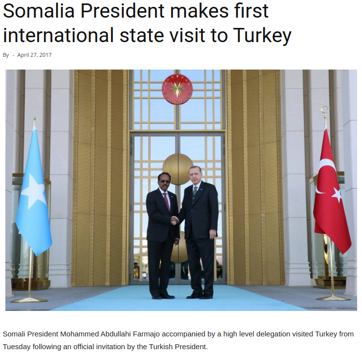
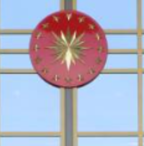
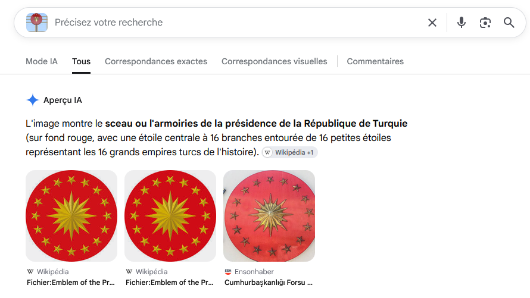
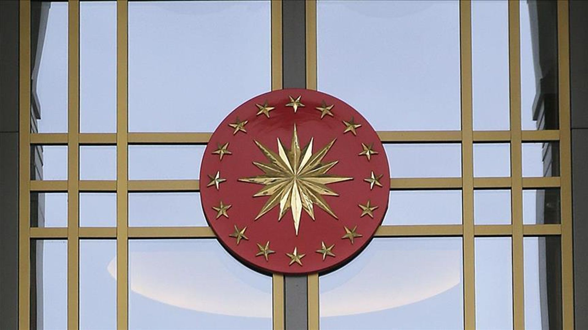
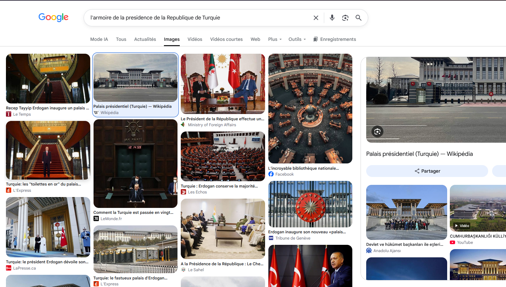
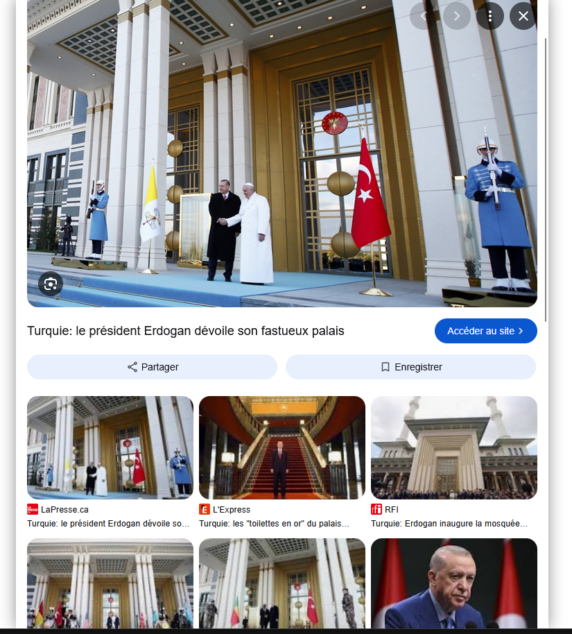
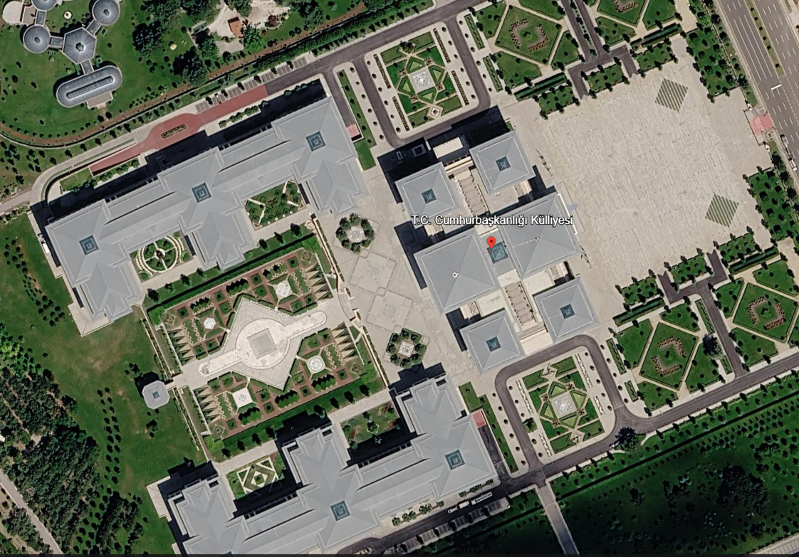
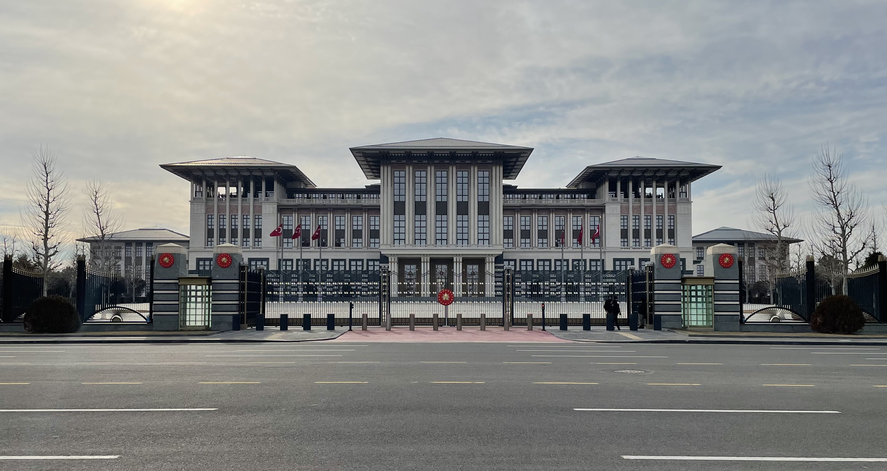

### **Réunion d'information des tâches:**

```
En avril 2017, Mohamed Abdullahi Farmaajo, alors président de la Somalie, s’est rendu en Turquie. Une agence de presse a publié une photo où on l'a vu se serrer la main de Recep Tayyip Erdo ? a, le président du pays. L'article n'a pas révélé où la photo a été prise.
```




## Mission

```bash
Votre tâche est de connaître le nom et les coordonnées de l'emplacement vu à droite.
```


le but du défi c'est de trouvé cet endroit qui est sur l'image ici nous avons une symbole qui est intéressent pour nos recherche en OSINT et le défi nous précise que c'est en `Turquie`

cherchons le symbole qui est sur l'image






d'après notre recherche sur google ce symbole est le `sceau ou l'armoire de la presidence de la Republique de Turquie`



nous avons trouver une correspondance visuelle 



d'après le résultat de la recherche du palais Présidentielle Turque nous avons plusieurs correspondance 



d'autre correspondance aussi 

**** nous allons maintenant faire la géolocalisation de cet emplacement 

**** Resultat de recherche google:

```
Le palais présidentiel de la République de Turquie, officiellement appelé le Complexe présidentiel (_Cumhurbaşkanlığı Külliyesi_) et parfois surnommé le _Palais blanc_ (_Ak Saray_), est le siège officiel de la présidence turque.
```

**Localisation :** Situé dans le quartier de **Beştepe** à Ankara (sur la Ferme forestière Atatürk).




vu satellitaire




il s'agit belle et bien de cette complexe trouvons son coordonnée géographique

## Coordonnée

`39°55'54.6"N 32°47'58.8"E`


